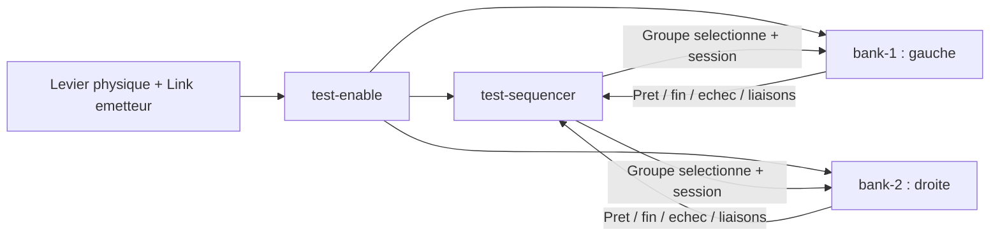
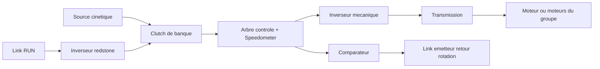

> **0.2.0 :** le nouveau graphe commun est `mintcraft-autopilot.clipboard.txt`. Voir [AUTOPILOT.md](AUTOPILOT.md). Les mélangeurs, sondes et branchements quad décrits ci-dessous restent des outils séparés ; ne pas les faire émettre en parallèle avec le nouveau pilote.

# Brancher Sputnik et tester automatiquement les deux sens

Cible : Cosmonautics **26.08.307**, Create 6.0.10. Aucun CC:Tweaked ni addon serveur
supplémentaire. Cette première procédure teste des **groupes de propulsion
horizontale réversibles**. Elle ne commande aucune pale de sustentation et ne
transforme pas un quadcopter sans propulsion horizontale en véhicule déjà calibré.

## 1. Importer le graphe déjà relié

Copier le contenu de `mintcraft-two-bank-tests.clipboard.txt` puis **Ctrl+V dans
le fond du graphe Sputnik**. Il ajoute quatre nœuds :

- **test-enable** : lecture d'un levier physique via une fréquence Link dédiée ;
- **test-sequencer** : sélection d'un seul groupe à la fois ;
- **bank-1** et **bank-2** : essais de chaque chaîne mécanique.

Les **20 liaisons logiques sont déjà posées**, avec leurs types numériques/texte.
La touche **F** sur le fond du graphe cadre tous les nœuds ; la molette permet
de dézoomer. Ne pas utiliser ce graphe en plus d'un autre contrôleur émettant sur les mêmes
fréquences. Sauvegarder le graphe précédent avant ajout.

Laisser le levier physique à **0**. Fermer/sauvegarder une première fois, rouvrir,
puis régler les widgets pour que leurs éléments existent aussi sur le serveur.
Le graphe est exécuté par le serveur après fermeture de l'éditeur. Un bouton Lua
local ne remplace pas le levier d'arrêt physique.

## 2. Quatre fréquences par groupe moteur, cinq si deux arbres indépendants

Si les deux moteurs d'une banque ont deux arbres indépendants, cocher
**Deux arbres indépendants** et ajouter un second Speedometer/comparateur/Link
sur la seconde chaîne. La séquence exige alors une rotation positive des **deux**
pour valider le mouvement, puis zéro sur les deux pour changer de sens. Un seul
moteur actif ne valide pas l'autre. Pour un arbre partagé, un seul retour suffit.

Le même câblage convient à une banque de deux moteurs, un moteur seul ou un
ensemble mécaniquement commun. Les deux moteurs de la banque Venator ne nécessitent
pas deux tests indépendants s'ils partagent la même chaîne de commande.

| Ligne du nœud bank | Côté véhicule | Sens utilisé |
| --- | --- | --- |
| **Transmission** | Redstone Link récepteur → entrée redstone de la transmission | Niveau d'arrêt et faible niveau d'essai explicitement renseignés |
| **Autorisation clutch via inverseur redstone** | Link récepteur → inverseur **redstone** (torche) → clutch | 0/absence = clutch alimenté, donc désengagé ; 15 = clutch libéré, donc engagé |
| **Inverseur mécanique** | Link récepteur → inverseur de rotation | 0 et 15 sélectionnent les deux sens |
| **Comparateur tachymètre** | Speedometer sur l'arbre contrôlé après le clutch → comparateur → Link **émetteur** | 0 = arbre arrêté, >0 = rotation détectée |

Pour chaque ligne, sélectionner dans les deux sélecteurs d'items **exactement la
paire de fréquence** du Link correspondant. Une paire est ordonnée. Employer des
paires différentes pour tous ces canaux, les deux banques et le levier Enable.
Le graphe refuse les doublons qu'il connaît ; il ne peut pas inventorier tous les
autres émetteurs du serveur ni authentifier leurs signaux.

L'**inverseur redstone** du clutch (une porte NON) et l'**inverseur mécanique** du
sens de rotation sont deux choses différentes.

L'absence de rafraîchissement du signal RUN doit **désengager** le clutch, au lieu
de remettre les moteurs en marche. Vérifier ce comportement matériel avant de
cocher sa confirmation. Prévoir également un levier de reprise prioritaire sur
les clutches horizontaux. Ne pas lier cette coupure aux quatre pales du Venator.

Le comparateur du Speedometer Create utilise `ceil(clamp(14 * dialTarget,0,15))` ;
ce retour donne une détection de rotation, **pas les RPM exacts ni le sens**.
L'observation du déplacement réel apporte la preuve du changement de sens.
Un signal nul sans rotation positive observée avant ne valide pas le test.

## 3. Régler les deux banques, une fois

Pour le Venator : `bank-1` = les deux moteurs arrière gauches, `bank-2` = les deux
arrière droits. Les numéros sont déjà 1 et 2. Dans chaque banque :

1. Choisir les quatre paires d'items selon le tableau.
2. Renseigner le **signal de transmission d'arrêt vérifié**. Ne pas supposer zéro.
3. Renseigner un **faible niveau d'essai qui fait tourner ce groupe**. La relation
   niveau→RPM/poussée n'est pas supposée linéaire. Aucun plein gaz automatique.
4. Confirmer que ce sont uniquement des moteurs horizontaux et que RUN 0/absence
   désengage effectivement le clutch avec le câblage décrit.
5. Laisser les bornes de petit essai ou les adapter explicitement : durée maximale
   **sous puissance** 0,5–10 s, déplacement maximal 1–32 m depuis le début du test.
   Valeurs initiales : 2 s et 8 m. Ce ne sont pas des limites de mission.

Dans `test-enable`, choisir la paire du Link émetteur relié au **levier physique**.
Ne pas connecter cette fréquence à un actionneur. Dans `test-sequencer`, conserver
le nombre de groupes à **2**. Fermer/sauvegarder avec le levier à **0**, laisser les
observations serveur établir le repos/armement, puis passer le levier à **15**.

La sustentation doit être contrôlée indépendamment pendant l'essai. Il faut du
dégagement et un état initial réellement stable. Le test refuse de poursuivre si
la hauteur dérive de plus de 0,5 m, si roulis/tangage s'écartent de plus de 8 degrés
ou si la masse change de plus de 2 %. Il arrête alors uniquement sa propulsion.
Il n'envoie aucun signal 15 ou zéro aux quatre pales de sustentation.

## 4. Déroulement automatique

Pour la banque 1, puis la banque 2, sans clic entre les étapes :

1. Autorisation clutch à 0 + transmission à l'arrêt renseigné.
2. Attente d'un **retour rotation nul et d'un véhicule au repos** : vitesse
   horizontale/verticale ≤0,1 m/s et variations d'attitude ≤1 degré/s, sur plusieurs
   observations distinctes. Pas de passage d'étape à l'expiration d'un délai.
3. Sélection du sens A, toujours clutch désengagé ; nouveau contrôle du repos.
4. Faible commande d'essai. Il faut une **rotation observée et au moins 0,25 m
   de déplacement horizontal**, confirmés par plusieurs observations après la
   commande. Dès ces preuves obtenues, arrêt de la banque.
5. Attente de l'arrêt mécanique et du véhicule, puis sélection du sens B.
6. Même mesure dans B. Le déplacement, exprimé dans l'axe horizontal du vaisseau
   au début de chaque essai, doit s'opposer au précédent.
7. Arrêt réellement observé, remise du sens A au repos, puis groupe suivant.

Le temps maximal sous puissance sert **uniquement à interrompre un essai sans
réponse suffisante**. Il ne suffit jamais à déclarer un mouvement ou un arrêt
réussi. Une attente d'arrêt peut durer sans que le programme ne redémarre le
moteur. Aucun réglage de puissance n'est augmenté automatiquement en cas de blocage.

Le test compare les deux sens A/B. Il ne prétend pas connaître l'avant visuel de
la construction à partir de son apparence. Les observations restent en mémoire
pour cette session ; aucun certificat de pilote, carte terrain ou modèle de vol
persistant n'est enregistré.

Abaisser le levier Enable interrompt la propulsion de test. Après une fin ou un
échec, il faut un nouveau passage par 0 avant de relancer. Un changement de
fréquence, de groupe ou de session pendant un essai le retire de l'armement.

## 5. Lire le résultat serveur

Ajouter un **Display Link Create sur Sputnik**, vers un Display Board. Les entrées
`MC_SEQUENCE`, `MC_BANK_1` et `MC_BANK_2` donnent les états serveur. L'éditeur Lua
évalue aussi son code côté client : ses widgets/pins ne sont pas une preuve live
de l'état serveur. Le monitor demeure séparé et ne coupe aucun actionneur.

La fin de séquence signifie : les deux sens et les arrêts de chaque groupe ont
été observés pour cette petite expérience. **L'autopilote n'est pas armé**.
Pas d'identité Sable ni de protection cryptographique des fréquences disponibles
par ces seules API ; ne pas assimiler cette expérience à une qualification de vol.

## Un autre véhicule

- Un seul groupe réversible : conserver bank-1, régler le séquenceur à **1**.
- De trois à huit groupes : ajouter des nœuds `mintcraft-bank-test.lua`, attribuer
  les numéros 3…8, relier les mêmes entrées Enable/Enable binding/Selected group/
  Session et retourner Group index/Ready/Bindings/Done session/Failed session aux
  ports correspondants du séquenceur.
- Deux groupes partageant réellement un canal ne se testent pas comme des groupes
  indépendants : les réunir ou distinguer leurs commandes physiques.
- Quad pur, rotor principal, brûleur ou commande collective de sustentation : ne
  pas les déclarer comme propulsion horizontale réversible. Leur identification
  nécessite un autre contrat d'essai et un maintien d'attitude/altitude adapté.

## Tests de développement

Les simulations couvrent les deux banques, le délai d'un tick des connexions
WGraph, l'ordre arrêt→inversion, le signal rotation absent/bloqué, les moteurs
sans mouvement, l'inverseur sans effet, STOP, les doublons de fréquences,
les changements de masse/dimension et les horloges invalides. Les fichiers sont
testés dans LuaJ du JAR ciblé et avec le **CODEC de synchronisation Sputnik réel**,
ainsi qu'avec l'écriture binaire NBT. Aucun monde Minecraft n'est disponible ici :
le fonctionnement en jeu doit encore être vérifié sur ce câblage.
