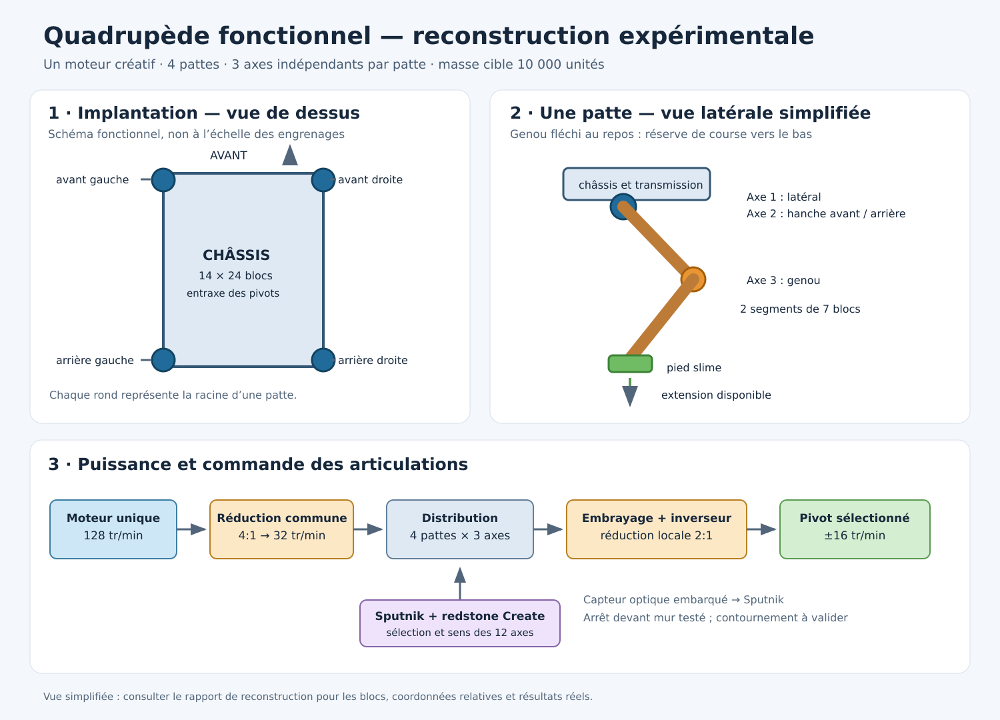

# Schéma et état de la reconstruction

[Schéma vectoriel SVG](schema-reconstruction.svg). Ce dessin décrit l'architecture et les fonctions : ce n'est pas un plan de placement bloc par bloc, ni une capture Minecraft. Les angles dessinés sont schématiques ; les dimensions des engrenages ne sont pas à l'échelle.

## Ce qui a été construit

La nouvelle version est reconstruite automatiquement dans une copie de monde : quatre pattes, chacune avec un pivot latéral, un pivot de hanche et un genou ; segments de sept blocs et pied en slime. Le châssis a un entraxe de 14 blocs entre les pattes gauche et droite et 24 blocs entre l'avant et l'arrière. Les anciens mécanismes de transmission à l'intérieur des pattes sont réutilisés : le projet ne prétend pas avoir inventé ou reconstruit une mécanique de patte entièrement différente. La modification est l'ajout d'une réduction commune de 4:1 avant la distribution, avec un moteur unique à 128 tr/min ; chaque axe conserve son embrayage, son inverseur et une réduction locale de 2:1, pour un objectif de ±16 tr/min.

Avec le châssis maintenu, un banc de 10 000 unités a commandé individuellement les douze axes en avant et en arrière : moteur 128 tr/min, axe sélectionné ±16 tr/min, autres axes à zéro ([événements](quad-shared-reduction-drive-v1/events.tsv), [mesures](quad-shared-reduction-drive-v1/drive.csv)). Une patte isolée a également fléchi et déplié son genou en synchronisant sa hanche : flexion mesurée 38,4°, mouvement vertical du pied environ 0,75 bloc, retour proche de sa position initiale ([pied](rebuilt-leg-reduction-v1/foot.csv), [orientations](rebuilt-leg-reduction-v1/poses.csv), [pignons](rebuilt-leg-reduction-v1/drive.csv)). Cette patte avait sa racine maintenue et n'était pas chargée.

## Sauvegarde de construction

[Monde de construction du quadrupède](quadrupede-128-construction.zip) : décompresser le dossier `Quadrupede_128` dans le dossier `saves` d'une installation utilisant le même modpack VENATOR. Le montage se trouve près de `32 180 32`. La sauvegarde a démarré puis été arrêtée proprement sur un serveur avec le modpack, sans l'outil temporaire d'observation ([résultat](quad-shared-reload-no-probe-v1/result.json)). C'est la construction sur banc : les corps sont verrouillés à la sauvegarde, le moteur est arrêté, la pose visible n'est pas celle du schéma fléchi et aucun programme Sputnik n'est préinstallé. Les essais de posture, marche et capteur ont été effectués dans des copies instrumentées distinctes : ne pas confondre cette sauvegarde de montage avec un quadrupède autonome prêt à marcher.

## Repères de construction de la réduction commune

Ces coordonnées sont relatives à la racine de la patte avant gauche, choisie comme `(0, 0, 0)` dans le banc. L'axe `z` va de l'avant vers l'arrière ; `x` sépare les côtés. Elles décrivent seulement la nouvelle réduction d'entrée : la nomenclature complète des articulations et de leur assemblage figure dans le [constructeur de test](../../../../../tools/minecraft-world-test/spot-quadruped/SpotQuadrupedIndependentReversible128Probe.java).

| Position relative `(x, y, z)` | Bloc / orientation | Fonction |
| --- | --- | --- |
| `(-15, 2, -2)` | Moteur créatif orienté est | Source unique, 128 tr/min |
| `(-14, 2, -2)` | Petite roue dentée, axe X | Entrée du premier étage |
| `(-14, 1, -3)` | Grande roue dentée, axe X | Premier étage, 2:1 |
| `(-13, 1, -3)` | Petite roue dentée, axe X | Entrée du second étage |
| `(-13, 0, -4)` | Grande roue dentée, axe X | Second étage, 2:1 |
| `(-12, 0, -4)` | Arbre, axe X | Sortie commune, 32 tr/min théoriques |
| `(-11, 0, -4)` | Inverseur global, axe X | Distribution existante |
| `(-10, 0, -4)` | Boîte d'engrenages | Départ du réseau de distribution |

Dans les tests, les corps et leurs axes sont créés dans une copie isolée et les observateurs temporaires sont retirés ensuite. Les coordonnées ci-dessus ne suffisent pas à elles seules à reconstruire le robot : les transmissions des pattes, leur collage et la configuration des embrayages doivent également être respectés. Le modèle de référence est le code du constructeur, pas une promesse que ces blocs peuvent être posés dans n'importe quel ordre.

## Limites et suite

La marche mesurée à 1,06 bloc/s, la pose fléchie et l'arrêt devant un mur décrits dans le [rapport précédent](../README.md) concernaient la version à moteur réglé à 32 tr/min. Les premiers essais de pose et de marche sur la réduction commune 128 → 32 → 16 figurent ci-dessous ; un premier arrêt devant mur et un essai de poussées figurent aussi ci-dessous. Le capteur optique détecte certains blocs déjà présents dans le pack, mais le verre n'a pas été détecté lors d'un essai ; un arrêt devant un mur ne prouve pas le contournement des obstacles. La perte de liaison redstone sans fil n'est pas encore distinguée d'un espace libre.

### Résultats sur le nouveau réseau à 128 tr/min

En essai libre sur sol plat, la posture synchronisée fléchit physiquement les genoux d'environ 38,0° à 41,4°. L'extension suivante fait passer la hauteur du corps de 180,766 à 181,487, soit environ 0,72 bloc ; l'inclinaison maximale relevée après activation sur la durée de l'essai est de 1,63°. Le moteur est à 128 tr/min et les vitesses de pignons observées sont −16, 0 ou +16 tr/min ([positions](quad-shared-extend-v1/stand.csv), [pignons](quad-shared-extend-v1/wireless.csv), [orientations](quad-shared-extend-v1/drive.csv)). Un seul essai, sans perturbation : il ne démontre pas encore un rattrapage.

Une marche à cycle de 12 ticks a parcouru 24,86 blocs nets entre les ticks 980 et 1480, en 25 secondes de jeu à 20 TPS, soit environ 0,99 bloc/s ; inclinaison maximale 2,50° ([positions](quad-shared-gait-v1/stand.csv), [pignons](quad-shared-gait-v1/wireless.csv)). La distance peut inclure du glissement. Un seul essai sur sol plat, sans obstacle ; ni les 10 blocs/s ni le parcours de 250 blocs ne sont validés.

Le capteur optique embarqué a aussi été essayé sur le nouveau réseau à 128 tr/min. Il a transmis à Sputnik la détection d'un mur de pierre ; la marche s'est arrêtée au tick 1027 avec une distance capteur–mur de 10,25 blocs. Après l'ordre, le déplacement net du corps a été de 0,45 bloc ; les pignons sont restés à l'arrêt à partir de cinq ticks après l'ordre ([capteur](quad-shared-optical-stop-v1/optical.csv), [mouvement](quad-shared-optical-stop-v1/stand.csv)). Ce n'est pas un contournement ; les limites du capteur et du lien mentionnées plus haut restent applicables.

Une première correction active synchronisée des hanches et genoux a ensuite été soumise à des impulsions successives. La première impulsion nominale 5 a été suivie de commandes d'extension et de repli. Après la deuxième, le corps a dépassé 30° au tick 1682 ; le banc a suspendu les poussées suivantes, tout en laissant la correction activée. Inclinaison finale 43,44° ; seules deux poussées sur huit ont été appliquées ([événements](quad-shared-recovery-v1/events.tsv), [mouvement](quad-shared-recovery-v1/stand.csv), [commandes](quad-shared-recovery-v1/wireless.csv)). La fin du protocole n'est pas une réussite de récupération. Les niveaux d'impulsion concernent le châssis du banc et ne sont ni des vitesses mesurées du robot entier ni des forces réelles.

Le témoin sans correction de la même série a également dépassé 30° après la deuxième impulsion et les six suivantes ont été suspendues. Son inclinaison maximale après impulsions était de 46,89° et sa finale de 42,03°, contre 49,10° et 43,44° pour la première correction active ([témoin](quad-shared-recovery-control-v1/events.tsv), [positions](quad-shared-recovery-control-v1/stand.csv)). Ces essais uniques ne montrent pas d'amélioration par la correction.

Une seconde correction a réduit de moitié le nombre d'impulsions d'extension et avancé la fenêtre de réarmement. Elle a elle aussi dépassé 30° après la deuxième poussée ; inclinaison maximale 49,83° et finale 43,21° ([événements](quad-shared-recovery-v2/events.tsv), [positions](quad-shared-recovery-v2/stand.csv)). Ni cette variante ni la précédente n'ont démontré un rattrapage utilisable. Les deux continuent à être des prototypes : le code est temporisé et ne mesure pas les contacts ou la position des articulations.

Une première commande de direction en n'activant qu'un côté a produit un changement de cap d'environ −5,76° pour 19,04 blocs de déplacement net sur 25 secondes de jeu, avec 2,48° d'inclinaison maximale ([positions](quad-shared-turn-one-side-v1/stand.csv)). C'est insuffisant pour conclure à un contournement. Un banc de calibration de la pose fléchie a également commandé successivement les quatre axes latéraux dans les deux sens, avec le moteur à 128 tr/min et les axes à 16 tr/min ([télémétrie](quad-shared-ground-roll-v1/telemetry.csv), [pignons](quad-shared-ground-roll-v1/wireless.csv)). Les changements d'orientation mesurés après chaque impulsion sont locaux et ne démontrent pas leur effet pendant une chute ou sous une forte poussée.

Un troisième prototype utilise les réponses locales mesurées des axes latéraux et commande des impulsions bornées quand le corps s'incline, sans arrêter le contrôleur après le seuil de 30°. Après la deuxième poussée, le corps a atteint 42,27°, puis est revenu à 3,96° à la fin ; le témoin sans correction reste à 42,03°. Le banc avait suspendu les six poussées suivantes après le dépassement de 30° : ce résultat porte donc sur deux poussées et une seule exécution par condition ([événements](quad-shared-roll-recovery-v1/events.tsv), [positions](quad-shared-roll-recovery-v1/stand.csv), [pignons](quad-shared-roll-recovery-v1/wireless.csv)). Les axes latéraux ont effectivement tourné, mais cet essai ne démontre pas une reprise fiable, une limite générale de poussée ni une correction optimale ; il doit être répété.

Une commande différentielle distincte, sur sol plat et sans mur, a produit un changement de cap d'environ +18,59° en 25 secondes de jeu pour 5,24 blocs nets, avec 1,67° d'inclinaison maximale ([positions](quad-shared-turn-differential-v1/stand.csv)). C'est une première rotation lente, pas un contournement autonome.

Un premier enchaînement « détection du mur, pause, rotation différentielle » a atteint une variation de cap indiquée par Sputnik de −25,17°, mais pendant la manœuvre la distance mesurée par le capteur au mur a chuté de 10,22 à 1,59 bloc, avec un minimum de 1,07 bloc au cours de l'essai ([capteur](quad-shared-optical-turn-v1/optical.csv), [positions](quad-shared-optical-turn-v1/stand.csv)). Cette manœuvre est un échec pour l'évitement : le capteur ne mesure pas la distance des pattes et l'essai ne permet pas d'écarter un contact avec le mur. Elle ne doit pas être présentée comme un contournement sûr.

La répétition du prototype de correction latérale a invalidé sa fiabilité : après deux impulsions appliquées et la suspension des six autres, l'inclinaison a atteint 173,16° et terminé à 172,31° ([événements](quad-shared-roll-recovery-repeat-v1/events.tsv), [positions](quad-shared-roll-recovery-repeat-v1/stand.csv), [pignons](quad-shared-roll-recovery-repeat-v1/wireless.csv)). Les deux exécutions actives ont donc des issues opposées. Il ne faut pas déployer cette correction comme rattrapage fiable.

Une variante interrompt la commande du virage si le signal optique atteint 8. Dans un essai, l'interruption est survenue au tick 1311, avec 8,17 blocs mesurés et un angle de −9,89°. Malgré l'arrêt des pignons, le corps a encore parcouru 2,93 blocs nets et l'angle final atteint −28,63°. La plus petite distance mesurée pendant que le mur restait visible était de 8,12 blocs, puis il est sorti du rayon optique ([capteur](quad-shared-optical-turn-v2/optical.csv), [positions](quad-shared-optical-turn-v2/stand.csv), [pignons](quad-shared-optical-turn-v2/wireless.csv)). Il ne s'agit pas d'une distance minimale garantie après perte de vue, ni d'un contournement validé : les côtés et les pieds ne sont pas surveillés et la dérive après l'arrêt reste importante.

Une quatrième variante commande uniquement l'axe latéral arrière gauche, choisi pour sa réponse locale à la calibration. Dans un essai, deux impulsions ont été appliquées puis les suivantes suspendues après dépassement de 30° ; l'inclinaison maximale était 37,69° et la finale 37,54° ([événements](quad-shared-roll-recovery-v2/events.tsv), [positions](quad-shared-roll-recovery-v2/stand.csv)). Elle est moins inclinée à la fin que le témoin de cette série, mais elle n'a pas redressé le corps et ne constitue pas une solution fiable.

Une première marche par paires diagonales a parcouru 12,61 blocs nets en 25 secondes de jeu, avec 2,14° d'inclinaison maximale, mais le déplacement comprend environ 9,40 blocs selon x et −8,41 selon z ([positions](quad-shared-gait-diagonal-v1/stand.csv), [pignons](quad-shared-gait-diagonal-v1/wireless.csv)). Dans cet essai, elle progresse moins et dévie davantage que la marche séquentielle ; elle n'est pas retenue comme amélioration de vitesse.
