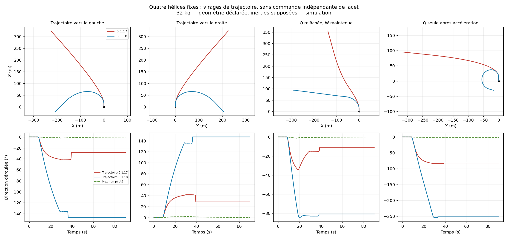

# Quatre hélices fixes : virages de trajectoire — 0.1.18

Le joueur conserve ses quatre hélices fixes et leurs quatre transmissions.
La nouvelle commande **courbe la trajectoire** avec Q/D plutôt que d'appliquer
une diagonale constante. **Elle ne commande pas la rotation du nez et ne
constitue pas un mode FPV complet.** Les deux angles sont mesurés séparément
dans le banc et affichés distinctement dans le statut.

Le profil principal reprend 32 kg, demi-largeur 3 blocs et demi-longueur 5 blocs.
Le centrage, les inerties 250/400/230 kg·m², la hauteur des rotors +1 bloc,
l'altitude Y=80 et la traînée restent des hypothèses. Les vrais scripts natifs
publiés sont exécutés dans le LuaJ de Cosmonautics, face à une plante 3D
indépendante ; aucun essai en monde Minecraft n'est revendiqué.

## Résultats

| Même scénario, pendant la commande de virage | Trajectoire 0.1.17 | Trajectoire 0.1.18 | Nez 0.1.18, variation totale |
| --- | ---: | ---: | ---: |
| Avancer puis maintenir Q | −40,47° | **−133,14°** | **−0,30°** |
| Avancer puis maintenir D | +40,47° | **+133,14°** | **+0,30°** |
| Q seule après accélération | −83,35° | **−243,55°** | **−1,97°** |
| Reculer puis maintenir Q | +40,47° | **−133,14°** | **−0,30°** |

Les directions de déplacement sont déroulées au fil du temps : −243° signifie
une courbe dépassant 180°, pas une sortie invalide de boussole. La variation
du nez inclut tout l'essai, freinage compris ; elle n'est pas mesurée sur le
même intervalle que la commande de virage. Elle peut provenir du couplage
physique sans être une commande indépendante de lacet.



Sur le profil joueur, **41/41 cas de référence** passent, contre 34/41 avec la
0.1.17 sur la même suite. Les nouveaux critères exigent une courbure qui dépasse
le simple passage vers une diagonale et vérifient l'absence de pivot artificiel
sur place. Les deux autres configurations passent **24/24** essais, soit
**65/65 essais de référence**. Sur les neuf autres essais, deux passent, un est
`LIFT_LIMIT`, et six échecs de mauvais montage restent présents. Les **74
exécutions finales** sont conservées dans les fichiers ci-dessous.

## Commande retenue

- W/S demandent une accélération sur la direction de trajet choisie. S permet
  aussi la marche arrière. Il n'y a toujours pas de plafond horizontal à 2 m/s.
- Q/D font évoluer progressivement la consigne de direction. Une accélération
  centripète et un retour sur l'écart de direction permettent de la suivre.
  Le cap ne continue pas à s'éloigner sans limite si le quad ne peut pas suivre.
- Relâcher Q/D en gardant W conserve le cap de trajet demandé. Relâcher toutes
  les commandes horizontales freine puis capture le point d'arrêt.
- Q/D seules à l'arrêt ne font ni pivoter le nez ni glisser le quad. Le cap de
  trajet est initialisé sur le nez à l'armement ; il peut ensuite en différer.
  Réarmer à l'arrêt permet de réinitialiser ce cap sur le nez mesuré.

La case **Q/D: virage de trajectoire (nez non pilote)** est activée par défaut.
La décocher, autorisation coupée, restaure le déplacement latéral classique.
Le SDK conserve lui aussi son mode classique si `config.steering=true` n'est
pas explicitement fourni.

Les quatre transmissions ne changent pas. Les gains d'attitude, la réserve
de sustentation et le mécanisme de freinage de la 0.1.17 restent utilisés.
Le statut montre `TRAJ` pour la consigne de déplacement et `NEZ` pour l'angle
mesuré du corps. `Body yaw controlled` reste explicitement à zéro.

## Pourquoi le nez n'est pas commandé

Dans Aeronautics 1.3.2 / Sable 2.0.6 audités, les petites hélices fixes
`BasePropellerBlockEntity` passent par
`BlockEntitySubLevelPropellerActor.applyForces`, qui applique une poussée au
point de montage. Cette voie ne fournit pas le couple de réaction autour
de l'axe du rotor d'un vrai quad. Dans le repère du véhicule, avec quatre
forces verticales, `couple_Y = somme(z × force_X − x × force_Z) = 0`.
Le modèle de portance/tangage/roulis a donc trois axes directement commandables.

La rotation du corps peut dériver par couplage dynamique. Un flywheel de
réaction utilise une autre voie physique ; il ne fait pas partie de ce montage.
Le code ne remplace pas cette autorité absente par un angle de nez fictif.
Un lacet indépendant demanderait un montage qui crée ce couple.

À vitesse élevée, une inclinaison limitée implique un grand rayon de virage :
`rayon ≈ vitesse² / accélération_latérale`. À 20 m/s et environ 8° d'inclinaison,
l'ordre de grandeur minimal est 260 m si toute l'accélération horizontale est
latérale, et davantage lorsqu'une partie sert à accélérer vers l'avant.
La consigne de direction est aussi bornée à 30°/s aux faibles vitesses.
Ce sont des limites physiques et de fonctionnement du contrôleur, pas une
quantification en huit directions de boussole.

## Latence des consignes

Après les validations existantes du clavier, les six récepteurs Link configurés
sont lus directement par le contrôleur. Cela évite d'attendre un étage de copie
des sorties du graphe. Dans le scénario W prolongé, le temps pour atteindre
1 m/s passe de **1,40 à 1,35 s**, cohérent avec un tick de moins à 20 TPS.
La première réaction dépend aussi du traitement du Link et de la physique ;
ce résultat n'est pas une garantie de latence réseau du serveur.

La case **Consignes clavier Link directes** est activée par défaut. La décocher,
autorisation coupée, conserve les entrées câblées pour un autre fournisseur
de consignes. Le statut indique `LINK` ou `GRAPH`.
Le clavier doit toujours être validé et armé ; les collisions de fréquences
restent refusées. Une lecture incorrecte revient au freinage/maintien plutôt
que de créer une demande moteur. Les tests vérifient l'appui frais, le
relâchement malgré une ancienne consigne du graphe, les valeurs invalides,
la validité du clavier et le retour au mode câblé.

La montée en régime des hélices reste celle du mod : 15 % de l'écart par tick,
soit 15 ticks pour dépasser 90 % d'un changement de régime. La réactivité
mécanique n'est pas transformée en réponse instantanée par cette correction.

## Fichiers et reproduction

- [Ancien contrôleur](baseline-0.1.17.md) — [CSV](baseline-0.1.17.csv), [paramètres et empreintes](baseline-0.1.17.json).
- [Contrôleur publié](corrected-0.1.18.md) — [CSV](corrected-0.1.18.csv), [paramètres et empreintes](corrected-0.1.18.json).
- [Autre géométrie, 65 kg](holdout-short.md) — [CSV](holdout-short.csv), [paramètres](holdout-short.json).
- [Inerties dissymétriques](holdout-mixed.md) — [CSV](holdout-mixed.csv), [paramètres](holdout-mixed.json).

Les essais ajoutent gauche/droite, marche arrière, virage sans accélération,
relâchement de la commande de direction, vent latéral, absence de traînée,
commande à l'arrêt et mode latéral classique. Les critères de retour en
maintien, d'erreurs finales, de vitesse et d'oscillations RMS restent actifs.
La suite standard contient aussi des assertions de virage et d'absence de
faux pivot à l'arrêt. Les scénarios de fréquences, mécanique, centre de masse
et rotor dégradé restent des échecs ; ils ne sont pas requalifiés.

```sh
python3 tools/test-sputnik-twin.py \
  --cosmonautics-jar /chemin/cosmonautics-26.08.307.jar \
  --java-home /chemin/jdk-21 --mass 32 --arm-x 3 --arm-z 5 \
  --output /tmp/quad-0118
```

Pour la figure comparative : `tools/plot-sputnik-twin.py --before ... --after ...
--course --output ...`. Les trajectoires complètes sont générées dans le dossier
de sortie et ne grossissent pas le ZIP de l'OS. Les inerties, le centre de
masse et la traînée du véhicule réel restent à mesurer ; ce banc ne lance pas
Minecraft ni son solveur physique et ne certifie pas un pilotage FPV.
