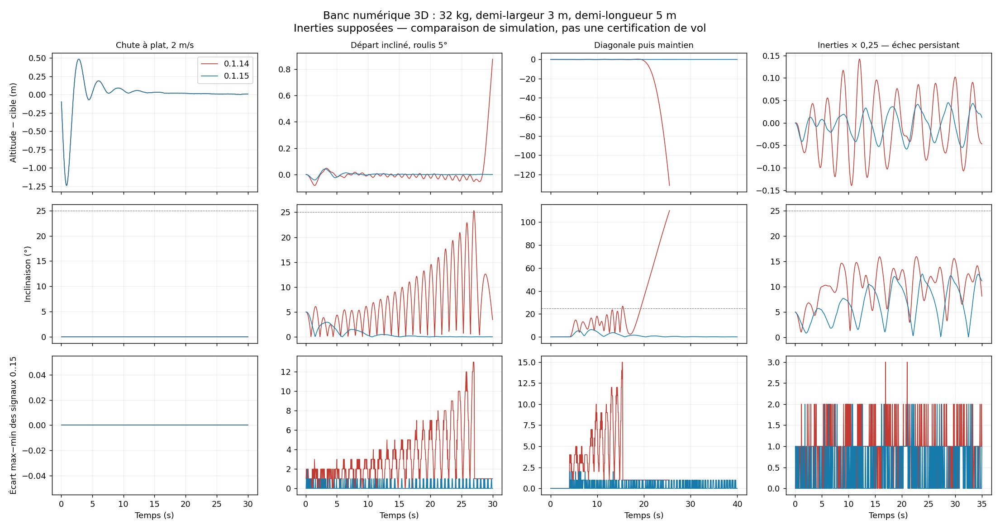

# Banc numérique du quad — 25 octobre 2026

Le banc a trouvé des oscillations dans la 0.1.14 et permis de corriger
l'amortissement et la boucle de translation dans la **0.1.15**. Les scripts
natifs livrés sont exécutés sans modification dans le LuaJ de Cosmonautics
26.08.307 ; le véhicule est une plante rigide indépendante, pas le solveur
Minecraft/Sable. **Ce n'est pas une certification de vol.**

Le profil reprend les données déclarées par le joueur : **32 kg, demi-largeur
3 blocs, demi-longueur 5 blocs**. La hauteur des rotors (+1 bloc), l'altitude
initiale (Y=80), le centrage et les inerties (250/400/230 kg·m²) restent des
hypothèses. Deux scénarios multiplient les trois inerties par 0,25 ou par 4,
en transmettant ces nouvelles valeurs au pilote, comme le ferait l'API serveur.

| Même profil, mêmes scénarios et critères | 0.1.14 | 0.1.15 |
| --- | ---: | ---: |
| Référence : chute, inclinaison, clavier, rafale, bruit, retards, masse et inerties | 12/20 | **19/20** |
| Écarts volontaires au modèle : centre décalé, rotor faible, fréquences ou mécanique erronées | 0/6 | **0/6** |

Le cas de référence encore en échec utilise des inerties quatre fois plus
faibles : vitesse finale environ **0,60 m/s** et écart horizontal **6,37 m**.
Une baisse des oscillations ne suffit donc pas à déclarer le maintien réussi.
Les six écarts volontaires restent tous des échecs, parfois avec retournement.
Même un petit décalage du centre de masse conserve un écart horizontal ; une
masse totale correcte ne remplace pas une géométrie correcte.



## Ce qui est simulé

- Corps rigide à six degrés de liberté, orientation quaternion, moments `r × F`,
  inerties diagonales et terme gyroscopique `ω × Iω`, intégration à 200 Hz.
- Quatre hélices distinctes, écoulement axial au point d'application, pression
  interpolée à partir des 421 valeurs de la vraie courbe Java de Sable.
- Transmissions quantifiées : 0 → 256 RPM, 1 → 224 RPM, 15 → arrêt ; montée
  en régime de 0,15 par tick. Les fréquences concurrentes combinent leur maximum.
- Nœuds natifs à 20 Hz, copie des sorties du tick précédent, retards radio de
  1, 2 ou 4 ticks ; la physique continue après la mise en défaut du pilote.
- Départs chauds/froids, chutes à 2 et 5 m/s, inclinaisons initiales, translation,
  diagonale, bruit de position, rafale, masse réduite en vol et masses de 40/85 kg.

Les scénarios classés comme réussis doivent rester actifs, finir à moins de
0,3 m d'erreur verticale **et horizontale**, à moins de 0,2 m/s, et rester sous
25° d'inclinaison. Ce critère porte sur l'erreur finale, pas sur l'excursion
transitoire : une chute rapide perd plusieurs mètres avant récupération.

Il manque les collisions, joints, contraintes, effet de sol, réseau cinétique
Create complet, inerties non diagonales et mesures réelles du véhicule. Les
coefficients de traînée sont supposés ; un cas supprime toute traînée du corps.
La montée en régime est modélisée, mais pas les moments gyroscopiques des pales.
Les erreurs de fréquence et les mauvais branchements mécaniques sont injectés,
pas lus automatiquement sur le serveur.

## Résultats complets et reproduction

- [Rapport 0.1.14](baseline-0.1.14.md), [CSV](baseline-0.1.14.csv), [paramètres et empreintes](baseline-0.1.14.json).
- [Rapport 0.1.15](corrected-0.1.15.md), [CSV](corrected-0.1.15.csv), [paramètres et empreintes](corrected-0.1.15.json).

Depuis la racine du dépôt, après génération de la distribution et avec les JAR
audités disponibles :

```sh
python3 tools/test-sputnik-twin.py \
  --cosmonautics-jar /chemin/cosmonautics-26.08.307.jar \
  --java-home /chemin/jdk-21 \
  --mass 32 --arm-x 3 --arm-z 5 \
  --output /tmp/mintcraft-twin
```

Les options `--ix`, `--iy`, `--iz` et `--height` permettent de remplacer les
hypothèses par les mesures réelles. Pour comparer à une autre version, extraire
son `mintcraft-quad-control.lua` puis fournir `--controller-file` et
`--controller-version`. Le lecteur de levier et le clavier sont les mêmes entre
ces deux versions ; seul le contrôleur est remplacé dans cette comparaison.

Le banc produit les 26 traces CSV complètes, un rapport, les paramètres et une
figure dans le dossier de sortie. Sa fin d'exécution signifie que le rapport
a été produit, **pas que tous les scénarios ont réussi**. Les tableaux et leurs
colonnes `status`/`first_fault` donnent le verdict de chaque essai. Les traces
volumineuses ne sont pas ajoutées à l'OS ni à son ZIP.

La figure comparative se régénère depuis les deux dossiers de traces :

```sh
python3 tools/plot-sputnik-twin.py \
  --before /tmp/mintcraft-twin-avant --after /tmp/mintcraft-twin-apres \
  --output /tmp/comparison.png
```
