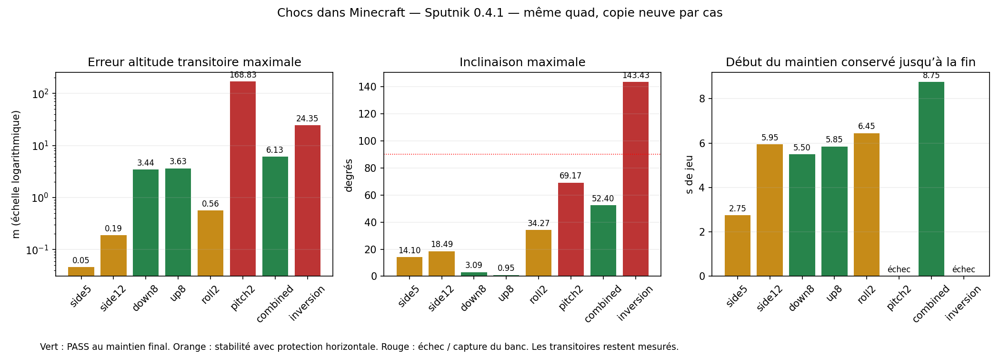
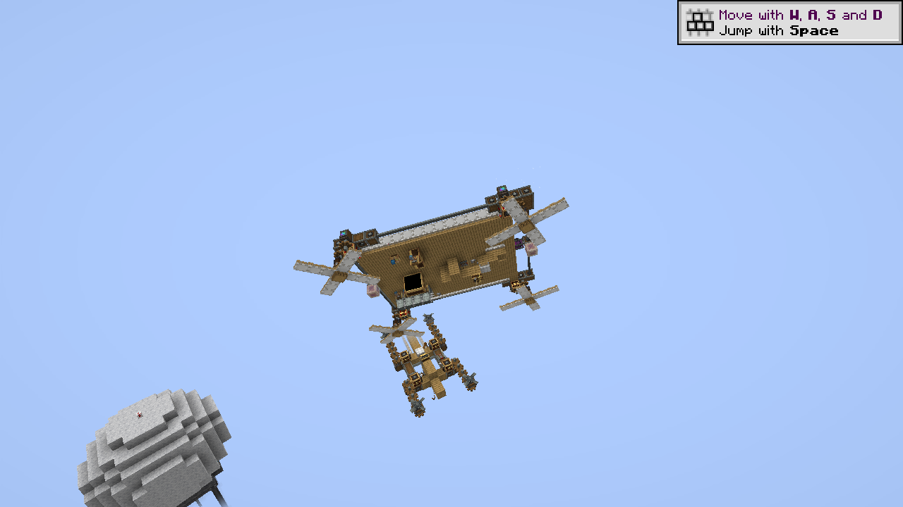
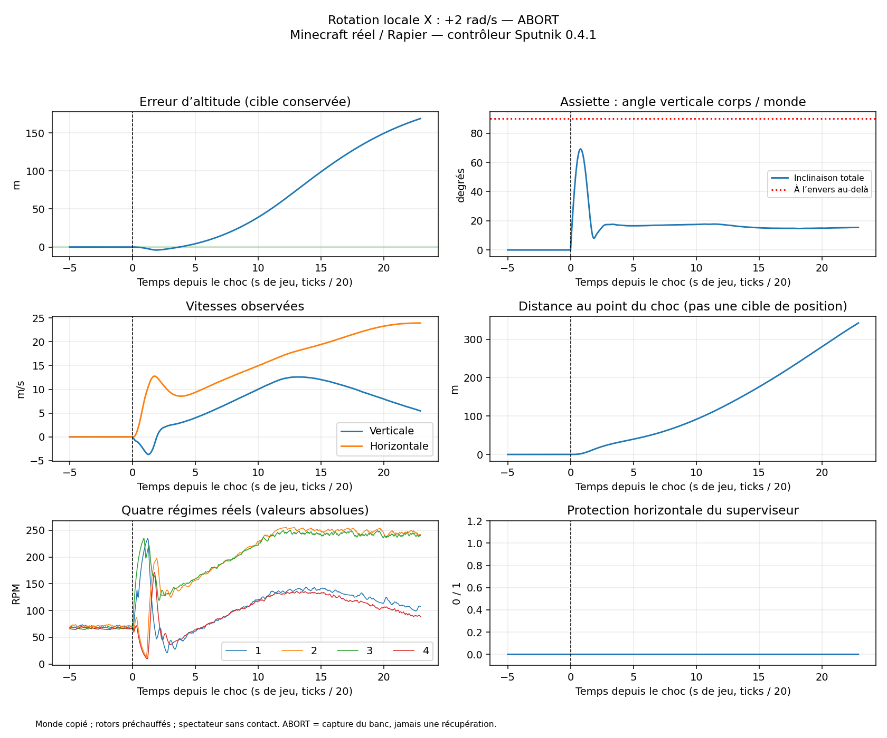

# Chocs physiques dans Minecraft — Sputnik 0.4.1

**Huit passages réels sur le même quad : 3 PASS, 3 PROTECTED, 2 échecs. Le redressement robuste n’est pas validé.** Les CSV, courbes et captures restent publiés, y compris les échecs. Ce sont les blocs du monde fourni et le solveur natif Sable/Rapier, sur une copie de serveur dédiée ; ce ne sont pas des résultats du jumeau numérique ni une session sur le serveur habituel de l’utilisateur.

## Protocole

Minecraft 1.21.1, NeoForge 21.1.264, Create 6.0.10, Aeronautics/Simulated 1.3.2, Sable 2.0.6, Cosmonautics 26.08.307. Le grand quad expose **193,5 kg**, quatre hélices modulaires de **12 voiles**, source **256 RPM**, bras proches de ±7 m en X et ±8 m en Z. L’altitude demandée reste environ **106,13 m**. Les fréquences et la géométrie sont préparées par instrumentation dans la copie ; ce n’est pas une fonction de scan ajoutée au Lua distribué.

Un nouveau monde copié et un nouveau serveur par choc, avec les mêmes contrôleur et superviseur 0.4.1 (`7129d4cc`). OFF/ON, préchauffage au trim sous verrou, réarmement, puis libération au tick 320. Le choc arrive au tick 800 ; réponse libre observée pendant 1 000 ticks, soit 50 s de jeu, sauf abandon. Aucune commande clavier de déplacement n’est injectée, aucune protection n’est acquittée et le contrôleur conserve l’unique propriété des sorties moteur. Aucun réglage de gain n’est changé entre les passages.

Le mod de test applique une impulsion unique dans la physique native : `J = masse × Δv` et `L = rotation_corps→monde × inertie_corps × Δω`. Il ne téléporte pas le véhicule pour créer le choc. Les translations sont exprimées dans le monde ; les rotations demandées sont autour des axes locaux du corps. Le cas combiné demande Δv=(7,−6,3) m/s et Δω=(1,5,0,1,5) rad/s. Les doses, impulsions calculées et vitesses avant choc figurent dans `events.tsv`.

Ce protocole teste une variation brutale de quantité de mouvement, **pas une collision, une explosion ou des dégâts aux blocs**. Le spectateur est sans contact et ne charge pas le véhicule. Seule sa caméra suit le quad. Un bâton physique capture le véhicule en fin de passage ou si y<80 m, si X/Z sortent de ±250 m depuis le départ, ou si le contrôleur se désactive. Cette capture du banc n’est jamais comptée comme une récupération. Aucun angle ne déclenche l’abandon du test. Ces limites ne sont pas ajoutées au pilote distribué.

## Critères et résultats

Avant le choc et en fin d’essai, 200 observations fraîches consécutives sont exigées : erreur d’altitude ≤1 m, |Vy|≤0,1 m/s, vitesse horizontale ≤0,2 m/s, inclinaison totale ≤5°, contrôleur actif. PASS exige aussi une perturbation physiquement observée, la fin du scénario, la cible conservée et aucune protection horizontale encore active. PROTECTED signifie retour au maintien avec protection à acquitter. ABORT signifie intervention du banc. FAIL signifie critère de maintien non atteint à la fin.

Le délai de reprise est le **début du maintien conservé jusqu’à la fin**, confirmé a posteriori par au moins 200 observations. Il peut inclure une protection horizontale. Ce n’est pas le premier passage bref à plat. Les pics transitoires restent distincts du maintien final.

| Choc | Résultat | Erreur altitude max (m) | Inclinaison max (°) | Reprise durable (s de jeu) | Erreur max des 10 dernières secondes observées (m) |
| --- | --- | ---: | ---: | ---: | ---: |
| [Choc latéral +5 m/s](side5.png) | PROTECTED | 0.046 | 14.1 | 2.75 | 0.003 |
| [Choc latéral +12 m/s](side12.png) | PROTECTED | 0.189 | 18.5 | 5.95 | 0.004 |
| [Chute : −8 m/s](down8.png) | PASS | 3.441 | 3.1 | 5.50 | 0.006 |
| [Projection : +8 m/s](up8.png) | PASS | 3.630 | 1.0 | 5.85 | 0.023 |
| [Rotation locale Z : +2 rad/s](roll2.png) | PROTECTED | 0.561 | 34.3 | 6.45 | 0.005 |
| [Rotation locale X : +2 rad/s](pitch2.png) | ABORT | 168.827 | 69.2 | — | 168.827 |
| [Choc translation + rotation](combined.png) | PASS | 6.129 | 52.4 | 8.75 | 0.016 |
| [Rotation locale Z : +6 rad/s](inversion.png) | FAIL | 24.353 | 143.4 | — | 24.287 |

**Le tangage échoue gravement.** Après une impulsion locale X de 2 rad/s, l’inclinaison atteint 69,2°. Le pilote reste en `RECOVERING`, conserve une inclinaison résiduelle et monte jusqu’à environ **169 m au-dessus de la cible**, en poursuivant un déplacement horizontal. Le banc capture le véhicule au tick 1258, soit 22,9 s après le choc, sur franchissement de l’enveloppe horizontale. La protection horizontale reste à zéro pendant cette divergence : le détecteur d’oscillation ne couvre pas à lui seul ce comportement. Le rapport décrit l’observation ; il ne prouve pas encore sa cause interne.

**Le retournement n’est pas récupéré durablement.** L’angle verticale corps/monde atteint **143,4°**, donc le véhicule passe effectivement à l’envers. Il revient à l’endroit mais perd **24,35 m** et alterne `HOLDING`, `RECOVERING` et `DEGRADED`. Le maintien demandé n’est pas atteint dans les 50 s observées. Une assiette redevenue droite ne vaut pas réussite de la tenue d’altitude.

Les chutes/projections de ±8 m/s reviennent au maintien mais dépassent 3 m d’erreur transitoire ; le choc combiné dépasse 6 m. Ces PASS ne certifient donc pas une précision sous un mètre pendant toute la perturbation. Les trois PROTECTED ne certifient pas une reprise automatique complète des commandes horizontales. Les huit passages ont une référence initiale stable, une cible conservée et aucune lacune de ticks après le choc. Un passage par dose ne constitue pas une estimation statistique de fiabilité.

## Captures authentiques et courbes

Les huit captures sont dans [captures/](captures/) avec [index et empreintes](captures/index.json). Les PNG sont copiés sans recadrage, retouche ni image synthétique. Les vues latérales `side5`/`side12` sont associées au passage par leur heure ; elles ne prétendent pas saisir le pic. Pour les six autres, un observateur X11 lit le dernier tick serveur avant d’acquérir le framebuffer. La latence de capture et l’interpolation client empêchent une correspondance exacte au tick indiqué dans le nom.

[PDF des huit passages et de leur comparaison](shocks.pdf). Chaque lien de la table ouvre les six courbes correspondantes : altitude, inclinaison totale, vitesses, déplacement, RPM et protection. Le dossier de chaque cas contient `flight.csv`, `events.tsv`, le relevé matériel et les résultats JSON. L’inclinaison totale est calculée par `acos(cos(pitch)×cos(roll))` à partir des angles YXZ exposés par Sputnik ; une inversion ne peut pas être masquée par un changement de branche d’Euler.

Les régimes sont les valeurs absolues mesurées sur les quatre arbres et les niveaux RX sont ceux des vrais Redstone Links. Dans les CSV, **wx/wy/wz sont les dérivées d’Euler de Sputnik en degrés/s**, pas la vitesse angulaire native en rad/s. Les temps sont les ticks de jeu divisés par 20 ; aucune performance temps réel de la machine de l’utilisateur n’en est déduite. Les échantillons de nettoyage sous verrou sont exclus du score. L’observation franchissant l’enveloppe est enregistrée avant capture et reste incluse dans les pics d’un ABORT.

## Rendu, incidents et reproductibilité

Le client utilise Xvfb 1280×720, Mesa llvmpipe, sans GPU matériel, distance de rendu 4 chunks et FPS limités à 10. Les mêmes mods et configurations du pack sont chargés, plus le mod spectateur de test. Les sons OGG n’ont pas été téléchargés ; le volume est coupé. Des avertissements Flywheel/Sable, des modèles manquants et un rendu partiel du terrain restent visibles dans cette installation logicielle. Les photos ne valident pas l’affichage du terrain, les obstacles ou les performances graphiques.

Après le passage tangage, un blocage de reconnexion du client a nécessité son redémarrage. Une pile Java observée passait par le calcul de forme de `TwinAutocannonBarrelBlock` puis la reconstruction du cache des tags ; ce constat ne suffit pas à attribuer la cause racine. Le serveur du passage tangage avait enregistré ABORT et capturé le quad avant de se bloquer à l’arrêt ; il a été terminé séparément. Ces incidents ne sont pas des réussites du modpack. Les deux derniers passages ont utilisé un client relancé, sans modification des mods ni du contrôleur. Les sorties et délais de processus sont conservés dans les JSON par cas.

Sources : [fixture et spectateur](../../../../tools/minecraft-world-test/shocks/), [compilation](../../../../tools/minecraft-world-test/build.py), [analyse et tracés](../../../../tools/report-sputnik-shocks.py), [tests du score](../../../../tools/test-sputnik-shock-report.py). Le guide du fixture donne les commandes de reproduction sur copie et les doses. Les trois variantes Java ont été recompilées contre les API installées. Les classes recompilées de choc et de spectateur sont identiques à celles exécutées. Huit tests indépendants du rapport vérifient notamment les horloges figées, les captures, les protections, l’absence de réponse, les essais incomplets et une cible déplacée pour masquer une erreur. Les empreintes sont dans [validation.json](validation.json).

Les mondes, inventaires, identités des joueurs, archives privées et mods tiers ne sont pas redistribués. Les volumes d’entrée sont ceux du [rapport précédent](../minecraft-0.4.1/validation.json). Ce test ne valide ni les autres architectures, ni une autre répartition de masse/COM, ni une charge suspendue, ni les dégâts en vol, ni le démarrage avec moteurs froids, ni les touches physiques du Linked Typewriter. Les sous-véhicules déjà présents dans le monde ne constituent pas un essai de charge suspendue instrumenté. Le cap du nez reste sans autorité de lacet validée.

Aucun code de commande n’a changé pour cette campagne. La version reste 0.4.1 et le [TXT complet préparé pour ce quad](../minecraft-0.4.1/venator-quad-configured.clipboard.txt) est inchangé ; ses échecs ci-dessus doivent accompagner son usage expérimental. **La priorité suivante est de corriger la récupération en tangage et la conservation de l’altitude pendant/après un retournement, puis de répéter les chocs sur les deux signes et d’autres géométries.**
