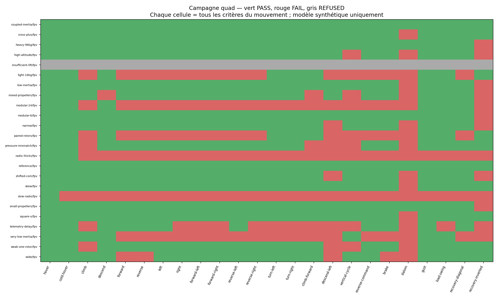
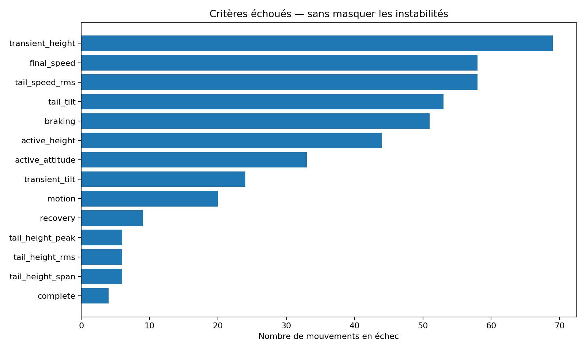

# Campagne lourde quad — contrôleurs Sputnik 0.3.2

**576 essais : 393 PASS, 159 FAIL, 24 REFUSED.** Aucun essai dans Minecraft. Un refus n'est jamais compté comme une stabilisation réussie.

24 configurations × 24 mouvements × 1 contrôleurs ; 9.14 heures simulées effectivement exécutées, 6,583,290 pas de mécanique et 658,329 cycles complets de commande intégrés. Temps réel du banc : 6.9 minutes avec quatre travailleurs maximum.

[Conclusions et corrections prioritaires](FINDINGS.md) · [Méthode détaillée](METHOD.md) · [Sensibilité 200/400 Hz](convergence/README.md)

Configurations ayant réussi **tous** les mouvements : 2/23 couples configuration/contrôleur acceptés. 1 autres couples sont refusés avant activation. Ce nombre seul ne constitue pas une qualification Minecraft.



## Contrat de validation

L’assiette demandée pendant un déplacement peut être inclinée. Le suivi de cette assiette et le maintien vertical sont évalués pendant le mouvement ; le retour à une assiette horizontale et à une vitesse faible est évalué séparément en fin de parcours. Les courbes sont conservées même pour les échecs. Les cases grises sont des configurations refusées avant activation, pas des essais dynamiques réussis.

Les conditions exactes, empreintes et hypothèses figurent dans [campaign.json](campaign.json). Les résultats par critère sont dans [results.json](results.json), les mesures comparables dans [results.csv](results.csv). Les 20 Hz du contrôleur et 200 Hz du corps rigide sont des pas de simulation ; ils ne garantissent pas les performances du serveur.

Les termes « architecture » désignent ici la géométrie et la motorisation des quadricoptères. Les ballons, Venator et hélicoptères ne sont pas inclus dans cette campagne. Les contrôleurs effectivement exécutés sont listés dans campaign.json. Les refus de configuration sont conservés ; la comparaison avec une version antérieure est un rapport distinct.

## Seuils communs par phase

- **complete** : 60 s de simulation terminées, aucune faute du contrôleur ni sortie de l’enveloppe déclarée.
- **tail_height_peak** : Erreur de hauteur maximale sur les 10 dernières secondes < 1 m.
- **tail_height_rms** : Erreur de hauteur RMS sur les 10 dernières secondes < 0,5 m.
- **tail_height_span** : Excursion de hauteur crête-à-crête sur les 10 dernières secondes < 1 m.
- **tail_tilt** : Inclinaison maximale sur les 10 dernières secondes < 5°.
- **tail_speed_rms** : Vitesse totale RMS sur les 10 dernières secondes < 0,35 m/s.
- **final_speed** : Vitesse totale finale < 0,3 m/s.
- **active_attitude** : Erreur de suivi d’assiette RMS < 5° et maximale < 10° pendant les phases actives, après 2 s de transition.
- **active_height** : Pour une translation horizontale : erreur de hauteur maximale < 1 m sur la même fenêtre active.
- **active_vertical_rate** : Quand Espace/Shift est maintenu : erreur RMS de vitesse verticale < 1 m/s après 2 s de transition.
- **motion** : Preuve physique du mouvement demandé (déplacement signé, vitesse ou courbure), indépendante du drapeau de commande.
- **braking** : Pour une commande horizontale : vitesse horizontale < 0,3 m/s pendant 15 observations fraîches consécutives au plus 6 s après relâchement.
- **transient_height** : Erreur de hauteur transitoire maximale < 2 m ; bornes distinctes 5 m au démarrage à froid/charge/perturbation diagonale, 15 m en inversion.
- **transient_tilt** : Inclinaison maximale < 35° hors essais explicites de récupération.
- **recovery** : Après perturbation : 20 observations consécutives à inclinaison < 5°, vitesse horizontale < 0,3 m/s et vitesse verticale absolue < 0,3 m/s en moins de 15 s.
- **rope** : Extension numérique maximale du câble < 0,03 m pour la charge pendulaire.

## Mouvements et protocoles

- **hover** : Maintien sans touche pendant toute la simulation.
- **cold-hover** : Même maintien, quatre rotors initialement immobiles, sans contact au sol modélisé.
- **climb** : Espace entre 5 et 10 s, puis relâchement et maintien de la hauteur atteinte.
- **descend** : Shift entre 5 et 10 s, puis relâchement et maintien.
- **forward** : W entre 5 et 10 s, freinage au relâchement.
- **reverse** : S entre 5 et 10 s, freinage au relâchement.
- **left** : Q entre 5 et 10 s, mode déplacement latéral.
- **right** : D entre 5 et 10 s, mode déplacement latéral.
- **forward-left** : W+Q entre 5 et 10 s, mode déplacement latéral.
- **forward-right** : W+D entre 5 et 10 s, mode déplacement latéral.
- **reverse-left** : S+Q entre 5 et 10 s, mode déplacement latéral.
- **reverse-right** : S+D entre 5 et 10 s, mode déplacement latéral.
- **turn-left** : W+Q entre 5 et 10 s, mode virage de trajectoire. Aucune rotation du nez exigée.
- **turn-right** : W+D entre 5 et 10 s, mode virage de trajectoire. Aucune rotation du nez exigée.
- **climb-forward** : W+Espace entre 5 et 10 s : translation et montée simultanées.
- **descend-left** : W+Q+Shift entre 5 et 10 s, mode latéral : diagonale et descente.
- **vertical-cycle** : Espace de 5 à 10 s, maintien 10–15 s, Shift 15–20 s, puis maintien.
- **reverse-command** : W de 5 à 10 s, S de 10 à 15 s, puis freinage.
- **brake** : W de 5 à 10 s, relâchement, délai de freinage mesuré sur 15 observations consécutives.
- **slalom** : W continu de 5 à 10 s, Q/D alternées toutes les 1,25 s, mode virage de trajectoire.
- **gust** : Aucune touche ; vent monde (5,0,-3) m/s de 5 à 10 s, puis maintien.
- **load-swing** : Aucune touche ; charge ponctuelle de 12 kg sur corde 5 m, inclinée initialement de 20°, ajoutée à 5 s.
- **recovery-diagonal** : Aucune touche ; perturbation de 15° autour de l’axe diagonal X/Z à 5 s.
- **recovery-inverted** : Aucune touche ; inversion instantanée de 180° à 5 s. Perte d’altitude publiée.

## Résultats par configuration

| Configuration / contrôleur | PASS | FAIL | REFUSED | Rapport détaillé |
| --- | ---: | ---: | ---: | --- |
| coupled-inertia / fpv | 24 | 0 | 0 | [24 mouvements](details/coupled-inertia-fpv.md) |
| cross-plus / fpv | 23 | 1 | 0 | [24 mouvements](details/cross-plus-fpv.md) |
| heavy-96kg / fpv | 23 | 1 | 0 | [24 mouvements](details/heavy-96kg-fpv.md) |
| high-altitude / fpv | 21 | 3 | 0 | [24 mouvements](details/high-altitude-fpv.md) |
| insufficient-lift / fpv | 0 | 0 | 24 | [24 mouvements](details/insufficient-lift-fpv.md) |
| light-16kg / fpv | 9 | 15 | 0 | [24 mouvements](details/light-16kg-fpv.md) |
| low-inertia / fpv | 22 | 2 | 0 | [24 mouvements](details/low-inertia-fpv.md) |
| mixed-propellers / fpv | 19 | 5 | 0 | [24 mouvements](details/mixed-propellers-fpv.md) |
| modular-24 / fpv | 6 | 18 | 0 | [24 mouvements](details/modular-24-fpv.md) |
| modular-6 / fpv | 23 | 1 | 0 | [24 mouvements](details/modular-6-fpv.md) |
| narrow / fpv | 21 | 3 | 0 | [24 mouvements](details/narrow-fpv.md) |
| paired-rotors / fpv | 9 | 15 | 0 | [24 mouvements](details/paired-rotors-fpv.md) |
| pressure-mismatch / fpv | 19 | 5 | 0 | [24 mouvements](details/pressure-mismatch-fpv.md) |
| radio-5ticks / fpv | 2 | 22 | 0 | [24 mouvements](details/radio-5ticks-fpv.md) |
| reference / fpv | 24 | 0 | 0 | [24 mouvements](details/reference-fpv.md) |
| shifted-com / fpv | 21 | 3 | 0 | [24 mouvements](details/shifted-com-fpv.md) |
| skew / fpv | 23 | 1 | 0 | [24 mouvements](details/skew-fpv.md) |
| slow-radio / fpv | 1 | 23 | 0 | [24 mouvements](details/slow-radio-fpv.md) |
| small-propellers / fpv | 23 | 1 | 0 | [24 mouvements](details/small-propellers-fpv.md) |
| square-x / fpv | 23 | 1 | 0 | [24 mouvements](details/square-x-fpv.md) |
| telemetry-delay / fpv | 11 | 13 | 0 | [24 mouvements](details/telemetry-delay-fpv.md) |
| very-low-inertia / fpv | 7 | 17 | 0 | [24 mouvements](details/very-low-inertia-fpv.md) |
| weak-one-rotor / fpv | 20 | 4 | 0 | [24 mouvements](details/weak-one-rotor-fpv.md) |
| wide / fpv | 19 | 5 | 0 | [24 mouvements](details/wide-fpv.md) |

## Principales limites révélées



La réussite du maintien seul ne certifie ni une diagonale, ni un virage, ni une montée avec déplacement. Les échecs et l’absence de réserve de poussée restent des travaux ouverts : les contrôleurs testés ont été figés pendant la campagne, sans ajustement des seuils après lecture des résultats.

La mécanique n’inclut ni collisions, ni réseaux de stress, ni contacts, ni solveur de joints Minecraft fidèle, ni couples gyroscopiques des hélices. Le câble est un modèle ponctuel unilatéral avec correction de dérive numérique. Les masses et inerties sont des scénarios synthétiques déclarés, pas un scan du vaisseau. Aucun lacet du nez n’est exigé de quatre hélices verticales fixes.

Les archives de traces et de courbes sont séparées de la distribution de vol. Chaque mouvement exécuté a une page de courbes dans le PDF de son couple configuration/contrôleur. Les sources gelées accompagnent les traces. La distribution de vol reste inchangée.

## Reproduire

Installer `numpy`, `matplotlib` et `pypdf` pour le rendu et la vérification. Les versions utilisées sont conservées dans `environment.json` lorsque ce fichier accompagne la campagne.

Depuis ce dépôt, avec le JDK 21 et le JAR Cosmonautics 26.08.307 dont l’empreinte est contrôlée :

```sh
python3 tools/test-quad-campaign-contract.py
python3 tools/run-sputnik-quad-campaign.py --cosmonautics-jar /chemin/cosmonautics.jar --java-home /chemin/jdk-21 --output /tmp/quad-report --work /tmp/quad-work --controllers fpv --tilt 20 --jobs 4
python3 tools/report-sputnik-quad-campaign.py --output /tmp/quad-report --work /tmp/quad-work
```

Utiliser des dossiers neufs. `--resume` exige exactement les mêmes sources, paramètres, critères et empreintes ; les traces terminées sont contrôlées avant réutilisation. Aucun téléchargement de JAR n’est effectué par le banc.

## Archives téléchargeables

- [campaign-traces-fpv.zip](campaign-traces-fpv.zip) : 62.4 Mo
- [campaign-plots-fpv.zip](campaign-plots-fpv.zip) : 22.6 Mo
