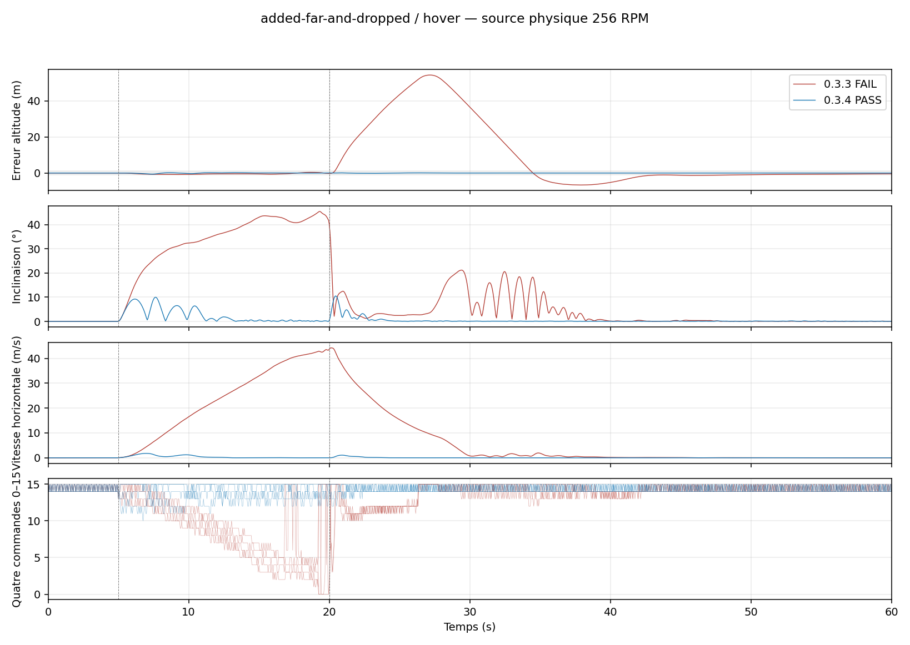

# Rééquilibrage quad 0.3.4 — charge décentrée

Le correctif estime un déséquilibre de couple à partir des commandes déjà émises et des accélérations angulaires observées. Il ajuste les bras de levier effectifs dans l’allocation et conserve la consigne verticale. Aucun balayage, aucune impulsion de calibration, aucune lecture fictive du centre de masse. La moyenne de modulation est transportée lors des variations de masse et d’inertie. Le solveur utilise désormais toute la famille de répartitions bornées, plutôt que de refuser une répartition de norme minimale négative alors qu’une autre solution existe.

## Protocole et critères

12 montages × maintien, avance/freinage et avance-gauche × deux versions = 72 scénarios, interpréteur LuaJ réel de Cosmonautics 26.08.307, mécanique indépendante à 200 Hz, contrôle à 20 Hz, 60 s par essai. Source 256 RPM et mêmes transmissions entières 0–15. Les charges ponctuelles modifient réellement masse, centre et tenseur complet selon le théorème des axes parallèles. Seuls la masse et les trois termes diagonaux sont transmis au contrôleur, avec pose et vitesse de l’origine fixe du véhicule ; jamais le centre réel ni les termes croisés. La vitesse exposée est la différence de poses fraîches à 20 Hz.

Une modification instantanée de masse conserve pose, vitesse et vitesse angulaire du châssis, sans impulsion de collision. La rampe est une succession de redistributions de masse suivant cette convention ; ce n’est pas une simulation de déplacement interne avec conservation du moment, ni un solveur de corde ou un essai Minecraft.

Le succès COM requiert la simulation complète, 1 201 observations espacées de 0,05 s, une altitude demandée inchangée, puis après chaque changement/fin de commande : 20 observations successives avec |Vy| ≤0,1 m/s, vitesse horizontale ≤0,2 m/s, inclinaison ≤5° et erreur de hauteur ≤1 m, obtenues en 15 s au plus. Les cinq dernières secondes de chaque épisode doivent aussi conserver hauteur <1 m, inclinaison <5° et RMS des vitesses verticale/horizontale <0,2 m/s. Un mouvement demandé doit produire le déplacement signé attendu. Les anciens critères complets restent publiés séparément dans `historical` ; un succès COM ne les remplace pas. Toutes les excursions figurent ci-dessous.

## Résultats

| Version | Succès COM | Échecs COM | Succès aux anciens critères |
| --- | ---: | ---: | ---: |
| 0.3.3 | 6 | 30 | 2 |
| 0.3.4 | 15 | 21 | 14 |

| Montage | Version | Mouvement | COM | Excursion hauteur max m | Inclinaison max ° | 20 observations stables après chaque épisode (s) | Défauts COM |
| --- | --- | --- | --- | ---: | ---: | --- | --- |
| same-mass-right | baseline | hover | FAIL | 0.46 | 9.66 | — | measured_stationary20, all_episode_tails_stable |
| same-mass-right | baseline | brake | FAIL | 1.30 | 29.70 | — | measured_stationary20, all_episode_tails_stable |
| same-mass-right | baseline | forward-left | FAIL | 0.35 | 14.80 | — | measured_stationary20, all_episode_tails_stable, motion_observed |
| same-mass-right | fixed | hover | FAIL | 0.38 | 7.74 | 54.60 | measured_stationary20 |
| same-mass-right | fixed | brake | PASS | 0.67 | 24.39 | 6.70 | — |
| same-mass-right | fixed | forward-left | FAIL | 4.20 | 48.12 | 10.00 | all_episode_tails_stable |
| same-mass-corner | baseline | hover | FAIL | 2.51 | 55.49 | — | measured_stationary20, all_episode_tails_stable |
| same-mass-corner | baseline | brake | FAIL | 2.80 | 55.23 | — | measured_stationary20, all_episode_tails_stable |
| same-mass-corner | baseline | forward-left | FAIL | 2.49 | 54.94 | — | measured_stationary20, all_episode_tails_stable, motion_observed |
| same-mass-corner | fixed | hover | PASS | 0.79 | 10.04 | 7.60 | — |
| same-mass-corner | fixed | brake | FAIL | 0.95 | 25.71 | 16.50 | measured_stationary20 |
| same-mass-corner | fixed | forward-left | PASS | 0.90 | 22.89 | 14.20 | — |
| same-mass-reverse | baseline | hover | FAIL | 5.65 | 52.48 | —, —, 9.30 | measured_stationary20, all_episode_tails_stable |
| same-mass-reverse | baseline | brake | FAIL | 2.80 | 66.52 | —, —, 8.35 | measured_stationary20, all_episode_tails_stable |
| same-mass-reverse | baseline | forward-left | FAIL | 2.49 | 61.55 | —, —, 7.85 | measured_stationary20, all_episode_tails_stable, motion_observed |
| same-mass-reverse | fixed | hover | FAIL | 1.56 | 25.38 | 7.60, —, 7.40 | measured_stationary20 |
| same-mass-reverse | fixed | brake | FAIL | 1.32 | 25.71 | —, —, 5.60 | measured_stationary20, all_episode_tails_stable |
| same-mass-reverse | fixed | forward-left | FAIL | 1.38 | 27.12 | —, 8.40, 5.95 | measured_stationary20, all_episode_tails_stable |
| added-load | baseline | hover | PASS | 0.39 | 5.26 | 4.40 | — |
| added-load | baseline | brake | PASS | 1.08 | 31.70 | 9.80 | — |
| added-load | baseline | forward-left | PASS | 0.72 | 24.88 | 8.95 | — |
| added-load | fixed | hover | PASS | 0.34 | 3.55 | 4.45 | — |
| added-load | fixed | brake | PASS | 0.60 | 19.67 | 8.05 | — |
| added-load | fixed | forward-left | PASS | 0.56 | 28.90 | 6.00 | — |
| added-far-and-dropped | baseline | hover | FAIL | 54.25 | 45.42 | —, 31.90 | measured_stationary20, all_episode_tails_stable |
| added-far-and-dropped | baseline | brake | FAIL | 28.91 | 49.78 | —, 25.90 | measured_stationary20, all_episode_tails_stable |
| added-far-and-dropped | baseline | forward-left | FAIL | 11.64 | 46.07 | —, 12.80 | measured_stationary20, all_episode_tails_stable, motion_observed |
| added-far-and-dropped | fixed | hover | PASS | 0.62 | 10.53 | 10.40, 5.95 | — |
| added-far-and-dropped | fixed | brake | FAIL | 0.95 | 32.85 | —, 6.25 | measured_stationary20, all_episode_tails_stable |
| added-far-and-dropped | fixed | forward-left | FAIL | 14.75 | 55.30 | —, 14.55 | measured_stationary20, all_episode_tails_stable |
| initial-unknown-corner | baseline | hover | FAIL | 2.44 | 55.36 | — | measured_stationary20, all_episode_tails_stable |
| initial-unknown-corner | baseline | brake | FAIL | 2.95 | 55.10 | — | measured_stationary20, all_episode_tails_stable |
| initial-unknown-corner | baseline | forward-left | FAIL | 2.63 | 54.59 | — | measured_stationary20, all_episode_tails_stable, motion_observed |
| initial-unknown-corner | fixed | hover | PASS | 0.87 | 10.65 | 8.80 | — |
| initial-unknown-corner | fixed | brake | FAIL | 1.13 | 21.76 | 16.45 | measured_stationary20 |
| initial-unknown-corner | fixed | forward-left | PASS | 0.87 | 23.48 | 11.20 | — |
| moving-load-ramp | baseline | hover | FAIL | 2.77 | 56.57 | — | measured_stationary20, all_episode_tails_stable |
| moving-load-ramp | baseline | brake | FAIL | 2.60 | 55.35 | — | measured_stationary20, all_episode_tails_stable |
| moving-load-ramp | baseline | forward-left | FAIL | 2.64 | 54.28 | — | measured_stationary20, all_episode_tails_stable, motion_observed |
| moving-load-ramp | fixed | hover | PASS | 0.22 | 4.66 | 6.70 | — |
| moving-load-ramp | fixed | brake | FAIL | 0.87 | 23.11 | 15.55 | measured_stationary20 |
| moving-load-ramp | fixed | forward-left | PASS | 0.74 | 24.06 | 13.70 | — |
| six-sails-corner | baseline | hover | FAIL | 76.62 | 85.72 | — | complete, measured_stationary20, all_episode_tails_stable |
| six-sails-corner | baseline | brake | FAIL | 76.63 | 87.48 | — | complete, measured_stationary20, all_episode_tails_stable |
| six-sails-corner | baseline | forward-left | FAIL | 76.57 | 86.65 | — | complete, measured_stationary20, all_episode_tails_stable, motion_observed |
| six-sails-corner | fixed | hover | FAIL | 0.70 | 9.62 | — | measured_stationary20, all_episode_tails_stable |
| six-sails-corner | fixed | brake | FAIL | 0.91 | 34.21 | — | measured_stationary20, all_episode_tails_stable |
| six-sails-corner | fixed | forward-left | FAIL | 0.81 | 29.16 | — | measured_stationary20, all_episode_tails_stable |
| heavy-with-added-load | baseline | hover | PASS | 0.32 | 5.83 | 4.20 | — |
| heavy-with-added-load | baseline | brake | PASS | 0.49 | 29.34 | 9.65 | — |
| heavy-with-added-load | baseline | forward-left | PASS | 0.32 | 23.45 | 7.75 | — |
| heavy-with-added-load | fixed | hover | PASS | 0.22 | 4.01 | 3.15 | — |
| heavy-with-added-load | fixed | brake | PASS | 0.55 | 20.33 | 7.40 | — |
| heavy-with-added-load | fixed | forward-left | PASS | 0.59 | 31.90 | 6.70 | — |
| mixed-sails-corner | baseline | hover | FAIL | 2.29 | 59.11 | — | measured_stationary20, all_episode_tails_stable |
| mixed-sails-corner | baseline | brake | FAIL | 2.67 | 58.81 | — | measured_stationary20, all_episode_tails_stable |
| mixed-sails-corner | baseline | forward-left | FAIL | 2.45 | 58.40 | — | measured_stationary20, all_episode_tails_stable, motion_observed |
| mixed-sails-corner | fixed | hover | PASS | 0.75 | 9.78 | 13.55 | — |
| mixed-sails-corner | fixed | brake | FAIL | 1.07 | 21.09 | 21.25 | measured_stationary20 |
| mixed-sails-corner | fixed | forward-left | FAIL | 1.10 | 19.94 | 15.45 | measured_stationary20 |
| delayed-noisy-right | baseline | hover | FAIL | 7.17 | 37.07 | — | measured_stationary20, all_episode_tails_stable |
| delayed-noisy-right | baseline | brake | FAIL | 8.72 | 35.44 | — | measured_stationary20, all_episode_tails_stable |
| delayed-noisy-right | baseline | forward-left | FAIL | 7.16 | 38.86 | — | measured_stationary20, all_episode_tails_stable, motion_observed |
| delayed-noisy-right | fixed | hover | FAIL | 3.51 | 34.01 | — | measured_stationary20, all_episode_tails_stable |
| delayed-noisy-right | fixed | brake | FAIL | 118.37 | 70.52 | — | measured_stationary20, all_episode_tails_stable |
| delayed-noisy-right | fixed | forward-left | FAIL | 3.46 | 40.96 | — | measured_stationary20, all_episode_tails_stable, motion_observed |
| outside-physical-support | baseline | hover | FAIL | 237.15 | 123.50 | — | complete, measured_stationary20, all_episode_tails_stable |
| outside-physical-support | baseline | brake | FAIL | 218.25 | 109.17 | — | complete, measured_stationary20, all_episode_tails_stable |
| outside-physical-support | baseline | forward-left | FAIL | 227.62 | 107.56 | — | complete, measured_stationary20, all_episode_tails_stable, motion_observed |
| outside-physical-support | fixed | hover | FAIL | 62.10 | 104.99 | — | measured_stationary20, all_episode_tails_stable |
| outside-physical-support | fixed | brake | FAIL | 28.23 | 97.90 | — | measured_stationary20, all_episode_tails_stable, motion_observed |
| outside-physical-support | fixed | forward-left | FAIL | 236.70 | 101.86 | — | measured_stationary20, all_episode_tails_stable, motion_observed |

## Limites

Le centre hors du polygone des hélices est volontairement irréalisable et reste un échec. Les montages avec forte hétérogénéité, délais, faibles marges de poussée ou changement pendant une manœuvre peuvent conserver des excursions et des échecs. L’estimation est un biais effectif : elle ne prouve pas un centre de masse mesuré ou une pale disparue. La position fournie par Sputnik n’est pas garantie au centre de masse ; sa rotation peut affecter l’altitude affichée. L’estimation évite d’apprendre un surpoids durant les accélérations angulaires importantes.

Le maintien ne peut être garanti pendant un retournement ou si la charge dépasse l’autorité disponible. Les autres architectures et le contrôleur standard ne sont pas modifiés. Voir aussi la [campagne de non-régression](../quad-campaign-0.3.4/README.md).

## Reproduction

`tools/test-sputnik-quad-com.py --help`, puis `tools/report-sputnik-quad-com.py` et `tools/verify-sputnik-quad-com.py`. Le fichier Lua 0.3.3 de référence doit être fourni explicitement. Les deux sources réellement exécutées, les critères et la mécanique sont gelés dans l’archive. La validation distincte de l’import SNBT/LuaJ est consignée dans le résumé de livraison.
