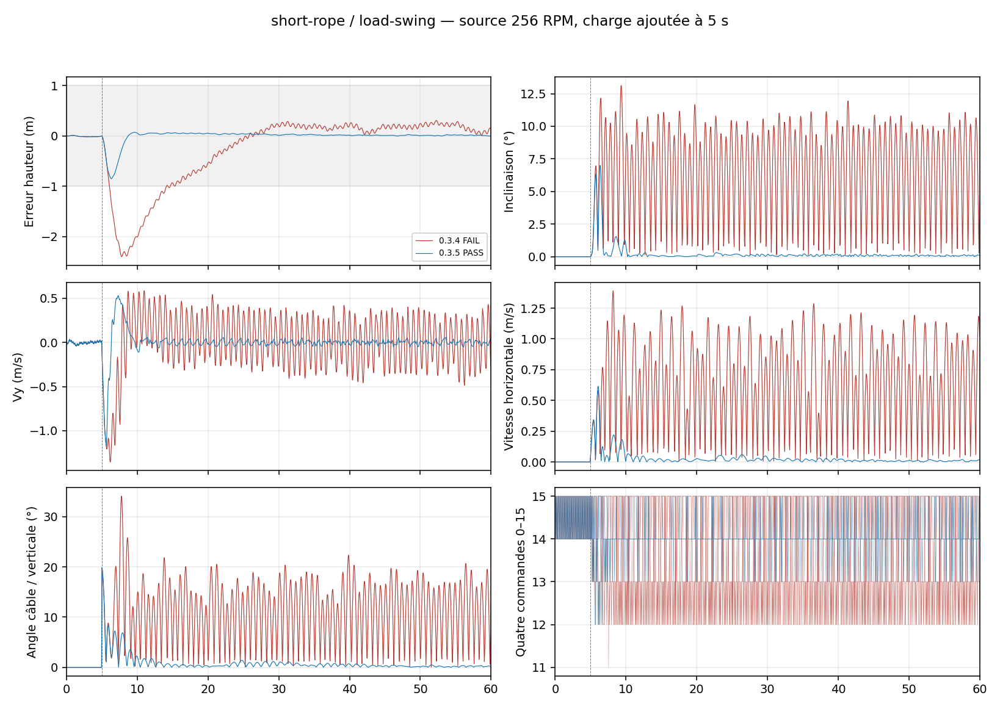

# Quad 0.3.5 — maintien avec charge suspendue

Le retour horizontal au maintien devient moins agressif lorsque le bilan vertical révèle une charge supplémentaire. La correction verticale apprend aussi pendant les mouvements angulaires modérés, avec son filtrage conservé ; elle ne reste plus gelée précisément quand la charge balance. Le freinage vertical est renforcé pour une commande verticale ou un effort extérieur estimé supérieur à 10 % de la gravité ; le gain précédent reste utilisé sans cet effort. La consigne de vitesse n’augmente pas. Les consignes, fréquences, modèle de poussée, régime 256 RPM et niveaux entiers 0–15 restent identiques. Aucun paramètre de corde ou poids suspendu n’est transmis au pilote.

## Banc et critères

8 montages × 6 mouvements × 2 versions = 96 scénarios à 60 secondes. Commande dans le LuaJ réel de Cosmonautics 26.08.307 à 20 Hz ; mécanique indépendante à 200 Hz. Masses de châssis 32/96 kg, charges 4/12/32 kg, cordes 2/5/10 m, attaches centrées/déportées et angles initiaux 20/40°. Chaque charge est ajoutée à 5 s, y compris pendant une commande. La masse exposée reste celle du châssis : le contrôleur n’accède ni au poids suspendu, ni à l’angle ou la longueur du câble. La position et la vitesse sont celles d’une origine fixe du corps ; la vitesse d’entrée est calculée par différence de positions fraîches à 20 Hz.

Le banc reprend la contrainte unilatérale de câble, les réactions au point d’attache et la projection de dérive des campagnes précédentes. Ce n’est pas le solveur de joints Minecraft, ni une corde multiple ou un objet étendu. Absence de collision/stress/effet de sol. Le moteur physique n’utilise pas l’allocation du contrôleur.

Les critères historiques restent tous actifs : hauteur finale <1 m, RMS <0,5 m, inclinaison finale <5°, vitesse RMS <0,35 m/s, suivi des commandes, freinage et excursions transitoires. Le plafond transitoire historique est de 5 m pour `load-swing` et de 2 m pour les autres mouvements. On ajoute un angle de câble <5° sur les dix dernières secondes et des observations espacées de 0,05 s. Une arrivée dans une bande pendant un instant ne suffit pas. Chaque résultat et chaque échec est conservé.

## Résultats

| Contrôleur | PASS | FAIL | REFUSED |
| --- | ---: | ---: | ---: |
| 0.3.4 | 9 | 39 | 0 |
| 0.3.5 | 29 | 19 | 0 |

| Montage | Version | Mouvement | Résultat | Pic hauteur m | Inclinaison finale max ° | Câble final max ° | Échecs |
| --- | --- | --- | --- | ---: | ---: | ---: | --- |
| reference | baseline | load-swing | PASS | 1.90 | 0.29 | 0.32 | — |
| reference | baseline | brake | FAIL | 2.01 | 0.21 | 0.44 | transient_height, active_height, braking |
| reference | baseline | forward-left | FAIL | 2.04 | 0.21 | 0.29 | transient_height, active_height, braking |
| reference | baseline | climb | FAIL | 2.16 | 0.22 | 0.26 | transient_height |
| reference | baseline | descend | FAIL | 2.65 | 0.53 | 0.67 | transient_height, active_attitude |
| reference | baseline | vertical-cycle | FAIL | 2.45 | 0.30 | 0.30 | transient_height, transient_tilt, active_attitude |
| reference | fixed | load-swing | PASS | 0.86 | 0.38 | 0.85 | — |
| reference | fixed | brake | FAIL | 1.09 | 0.21 | 0.57 | braking |
| reference | fixed | forward-left | FAIL | 0.96 | 0.23 | 0.29 | braking |
| reference | fixed | climb | PASS | 1.50 | 0.23 | 0.23 | — |
| reference | fixed | descend | PASS | 1.03 | 0.44 | 0.92 | — |
| reference | fixed | vertical-cycle | PASS | 1.50 | 0.25 | 0.80 | — |
| offset | baseline | load-swing | PASS | 2.41 | 0.22 | 0.40 | — |
| offset | baseline | brake | FAIL | 2.11 | 10.20 | 5.97 | tail_tilt, tail_speed_rms, final_speed, transient_height, active_height, braking, cable_settled |
| offset | baseline | forward-left | FAIL | 1.99 | 10.14 | 6.38 | tail_tilt, tail_speed_rms, final_speed, active_height, braking, cable_settled |
| offset | baseline | climb | FAIL | 2.13 | 0.19 | 0.23 | transient_height |
| offset | baseline | descend | FAIL | 2.89 | 0.18 | 0.38 | transient_height, active_attitude |
| offset | baseline | vertical-cycle | FAIL | 2.13 | 0.23 | 0.30 | transient_height |
| offset | fixed | load-swing | PASS | 0.79 | 0.29 | 0.59 | — |
| offset | fixed | brake | FAIL | 1.11 | 0.29 | 0.55 | braking |
| offset | fixed | forward-left | FAIL | 0.87 | 0.17 | 0.17 | braking |
| offset | fixed | climb | PASS | 1.48 | 0.17 | 0.26 | — |
| offset | fixed | descend | FAIL | 0.84 | 0.21 | 0.31 | active_attitude |
| offset | fixed | vertical-cycle | PASS | 1.48 | 0.29 | 0.45 | — |
| heavy-load | baseline | load-swing | FAIL | 10.01 | 14.85 | 9.58 | tail_tilt, tail_speed_rms, final_speed, transient_height, cable_settled |
| heavy-load | baseline | brake | FAIL | 5.72 | 15.44 | 8.87 | tail_tilt, tail_speed_rms, final_speed, transient_height, active_height, braking, cable_settled |
| heavy-load | baseline | forward-left | FAIL | 6.26 | 15.14 | 9.14 | tail_tilt, tail_speed_rms, final_speed, transient_height, active_height, braking, cable_settled |
| heavy-load | baseline | climb | FAIL | 8.36 | 15.31 | 9.42 | tail_tilt, tail_speed_rms, final_speed, transient_height, active_vertical_rate, cable_settled |
| heavy-load | baseline | descend | FAIL | 6.49 | 14.34 | 9.07 | tail_tilt, tail_speed_rms, final_speed, transient_height, transient_tilt, active_attitude, active_vertical_rate, cable_settled |
| heavy-load | baseline | vertical-cycle | FAIL | 7.75 | 14.54 | 8.92 | tail_tilt, tail_speed_rms, final_speed, transient_height, transient_tilt, active_attitude, active_vertical_rate, cable_settled |
| heavy-load | fixed | load-swing | PASS | 2.20 | 0.25 | 0.41 | — |
| heavy-load | fixed | brake | FAIL | 2.27 | 0.24 | 0.29 | transient_height, active_height, braking |
| heavy-load | fixed | forward-left | FAIL | 2.11 | 0.17 | 0.30 | transient_height, active_height, braking |
| heavy-load | fixed | climb | PASS | 1.71 | 0.17 | 0.18 | — |
| heavy-load | fixed | descend | FAIL | 1.52 | 0.25 | 0.27 | active_attitude |
| heavy-load | fixed | vertical-cycle | PASS | 1.71 | 0.17 | 0.25 | — |
| long-rope | baseline | load-swing | PASS | 2.03 | 0.23 | 0.08 | — |
| long-rope | baseline | brake | FAIL | 2.05 | 0.20 | 0.31 | transient_height, active_height, braking |
| long-rope | baseline | forward-left | FAIL | 2.09 | 0.20 | 0.34 | transient_height, active_height, braking |
| long-rope | baseline | climb | FAIL | 2.21 | 0.20 | 0.14 | transient_height |
| long-rope | baseline | descend | FAIL | 2.13 | 0.50 | 0.45 | transient_height, active_attitude |
| long-rope | baseline | vertical-cycle | FAIL | 2.21 | 0.16 | 0.22 | transient_height, active_attitude |
| long-rope | fixed | load-swing | PASS | 0.81 | 0.26 | 0.30 | — |
| long-rope | fixed | brake | FAIL | 1.09 | 0.22 | 0.37 | active_height, braking |
| long-rope | fixed | forward-left | FAIL | 0.94 | 0.21 | 0.24 | braking |
| long-rope | fixed | climb | PASS | 1.55 | 0.29 | 0.25 | — |
| long-rope | fixed | descend | PASS | 1.01 | 0.35 | 0.30 | — |
| long-rope | fixed | vertical-cycle | PASS | 1.55 | 0.38 | 0.53 | — |
| large-board | baseline | load-swing | FAIL | 1.80 | 18.83 | 45.16 | tail_tilt, tail_speed_rms, final_speed, cable_settled |
| large-board | baseline | brake | FAIL | 1.86 | 17.60 | 29.82 | tail_tilt, tail_speed_rms, final_speed, active_height, braking, cable_settled |
| large-board | baseline | forward-left | FAIL | 1.77 | 19.09 | 38.69 | tail_tilt, tail_speed_rms, final_speed, active_height, braking, cable_settled |
| large-board | baseline | climb | FAIL | 1.36 | 20.30 | 51.13 | tail_tilt, tail_speed_rms, final_speed, active_attitude, cable_settled |
| large-board | baseline | descend | FAIL | 2.42 | 0.15 | 0.23 | transient_height, active_attitude |
| large-board | baseline | vertical-cycle | FAIL | 2.19 | 19.23 | 35.58 | tail_tilt, tail_speed_rms, transient_height, active_attitude, cable_settled |
| large-board | fixed | load-swing | PASS | 0.71 | 0.18 | 0.15 | — |
| large-board | fixed | brake | FAIL | 0.84 | 0.18 | 0.18 | braking |
| large-board | fixed | forward-left | FAIL | 0.72 | 0.15 | 0.19 | braking |
| large-board | fixed | climb | PASS | 1.65 | 0.19 | 0.15 | — |
| large-board | fixed | descend | FAIL | 0.95 | 0.11 | 0.20 | active_attitude |
| large-board | fixed | vertical-cycle | PASS | 1.65 | 0.22 | 0.27 | — |
| short-rope | baseline | load-swing | FAIL | 2.40 | 11.08 | 20.68 | tail_tilt, tail_speed_rms, final_speed, cable_settled |
| short-rope | baseline | brake | FAIL | 1.94 | 0.31 | 0.70 | active_height, braking |
| short-rope | baseline | forward-left | FAIL | 2.08 | 11.65 | 21.61 | tail_tilt, tail_speed_rms, final_speed, transient_height, active_height, braking, cable_settled |
| short-rope | baseline | climb | FAIL | 2.11 | 0.29 | 0.61 | transient_height |
| short-rope | baseline | descend | FAIL | 2.39 | 10.57 | 18.59 | tail_tilt, tail_speed_rms, final_speed, transient_height, active_attitude, cable_settled |
| short-rope | baseline | vertical-cycle | FAIL | 2.11 | 0.20 | 0.69 | transient_height |
| short-rope | fixed | load-swing | PASS | 0.85 | 0.19 | 0.50 | — |
| short-rope | fixed | brake | FAIL | 1.09 | 0.32 | 0.80 | braking |
| short-rope | fixed | forward-left | PASS | 0.95 | 0.19 | 0.82 | — |
| short-rope | fixed | climb | PASS | 1.52 | 0.22 | 0.42 | — |
| short-rope | fixed | descend | PASS | 0.99 | 0.64 | 1.29 | — |
| short-rope | fixed | vertical-cycle | PASS | 1.52 | 0.21 | 0.79 | — |
| large-swing | baseline | load-swing | PASS | 2.32 | 0.29 | 0.68 | — |
| large-swing | baseline | brake | FAIL | 2.14 | 0.28 | 0.59 | transient_height, active_height, braking |
| large-swing | baseline | forward-left | FAIL | 2.15 | 0.21 | 0.23 | transient_height, active_height, braking |
| large-swing | baseline | climb | PASS | 1.95 | 0.24 | 0.29 | — |
| large-swing | baseline | descend | FAIL | 2.99 | 0.35 | 1.37 | transient_height, active_attitude |
| large-swing | baseline | vertical-cycle | FAIL | 2.45 | 0.37 | 0.60 | transient_height, transient_tilt, active_attitude |
| large-swing | fixed | load-swing | PASS | 1.08 | 0.18 | 0.33 | — |
| large-swing | fixed | brake | FAIL | 1.21 | 0.24 | 0.43 | braking |
| large-swing | fixed | forward-left | FAIL | 1.01 | 0.21 | 0.28 | braking |
| large-swing | fixed | climb | PASS | 1.51 | 0.22 | 0.17 | — |
| large-swing | fixed | descend | FAIL | 1.20 | 0.32 | 0.62 | active_attitude |
| large-swing | fixed | vertical-cycle | PASS | 1.51 | 0.46 | 0.54 | — |
| light-load | baseline | load-swing | PASS | 0.48 | 0.20 | 1.09 | — |
| light-load | baseline | brake | FAIL | 1.01 | 0.39 | 0.91 | active_height, braking |
| light-load | baseline | forward-left | FAIL | 1.01 | 0.18 | 0.51 | active_height, braking |
| light-load | baseline | climb | PASS | 1.98 | 0.42 | 0.82 | — |
| light-load | baseline | descend | PASS | 1.55 | 0.20 | 0.77 | — |
| light-load | baseline | vertical-cycle | PASS | 1.98 | 0.16 | 0.55 | — |
| light-load | fixed | load-swing | PASS | 0.46 | 0.23 | 0.60 | — |
| light-load | fixed | brake | FAIL | 0.85 | 0.39 | 0.83 | braking |
| light-load | fixed | forward-left | FAIL | 0.74 | 0.30 | 1.23 | braking |
| light-load | fixed | climb | PASS | 1.45 | 0.52 | 0.96 | — |
| light-load | fixed | descend | PASS | 1.44 | 0.29 | 0.73 | — |
| light-load | fixed | vertical-cycle | PASS | 1.47 | 0.37 | 0.96 | — |

## Limites et reproduction

Une réussite synthétique ne garantit pas la stabilité du montage montré en jeu. Les défauts de géométrie déclarée, délais, marges de poussée et plusieurs cordes/charges articulées ne sont pas identifiés automatiquement. Le pilote estime un effort extérieur ; il n’annonce pas connaître la masse réelle de la charge ni sa cause. Les paramètres d’architecture restent nécessaires et la fermeture de l’éditeur n’est pas un arrêt physique.

Voir la [campagne générale](../quad-campaign-0.3.5/README.md) et ses régressions. Les deux contrôleurs, critères, paramètres mécaniques et traces exactes sont gelés dans les archives. `tools/test-sputnik-quad-load.py`, `tools/report-sputnik-quad-load.py` et `tools/verify-sputnik-quad-load.py` reproduisent et vérifient ces résultats. Le fichier Lua 0.3.4 est fourni explicitement comme référence.

Le [prototype rejeté](rejected-prototype.zip) conserve ses 24 essais natifs de référence et sources : le gain vertical renforcé sans condition régressait en translation latérale (22/24, inclinaison supérieure à 42°). Il a été remplacé avant livraison. Ce fichier est une preuve de test, pas un graphe à importer.
