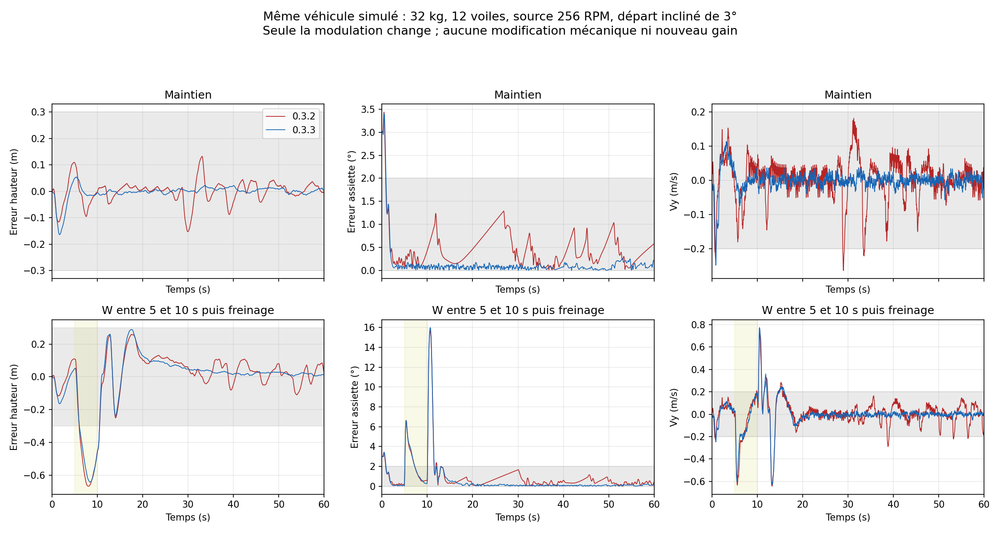

# Modulation quad 0.3.3 — correction à 256 RPM inchangés

Le correctif retire uniquement le raccourci qui imposait une sortie commune lorsque les quatre demandes différaient de moins de 0,08 niveau. Ce raccourci effaçait aussi le résidu de couple. Un même quantificateur couplé conserve maintenant les petites corrections et leur moyenne temporelle. Les gains, la géométrie, le régime mécanique et les niveaux 0–15 restent inchangés.

**Le banc utilise réellement 256 RPM dans les deux modèles mécaniques**, avec les mêmes masses, inerties et voiles. Le contrôleur ne demande aucune réduction mécanique ni nouvelle saisie. La référence utilise 32 kg, quatre hélices de 12 voiles et les bras X=±3/Z=±5.

## Temps de stabilisation durable : référence à 3°

Les bandes du diagnostic sont conservées : hauteur <0,3 m, erreur d’assiette <2°, |Vy|<0,2 m/s, vitesse horizontale <0,3 m/s après commande horizontale. Une seconde stable doit subsister jusqu’à la fin de la trace, sans sortie ultérieure. Ce sont des critères de recherche plus stricts que les anciens seuils finaux. Le chronomètre part de la fin de commande ou de la perturbation.

| Mouvement | 0.3.2 s | 0.3.3 s | Sorties après première seconde stable : avant → après |
| --- | ---: | ---: | --- |
| hover | 33.70 | 0.95 | 2 → 0 |
| cold-hover | 48.90 | 5.75 | 3 → 0 |
| climb | 20.20 | 3.70 | 1 → 0 |
| descend | 33.90 | 5.30 | 2 → 0 |
| forward | 46.60 | 5.95 | 3 → 0 |
| reverse | 40.10 | 5.95 | 1 → 0 |
| left | 22.00 | 6.40 | 1 → 1 |
| right | 4.20 | 6.75 | 0 → 0 |
| forward-left | 6.00 | 4.20 | 0 → 0 |
| forward-right | 5.85 | 4.20 | 1 → 0 |
| reverse-left | 43.60 | 4.20 | 1 → 0 |
| reverse-right | 48.50 | 4.20 | 4 → 0 |
| turn-left | 38.85 | 3.85 | 2 → 0 |
| turn-right | 46.10 | 3.90 | 2 → 0 |
| climb-forward | 9.30 | 6.35 | 1 → 0 |
| descend-left | 16.00 | 7.15 | 1 → 0 |
| vertical-cycle | absente | 3.95 | 1 → 0 |
| reverse-command | 37.20 | 6.90 | 2 → 0 |
| brake | 46.60 | 5.95 | 3 → 0 |
| slalom | 13.05 | 6.00 | 1 → 0 |
| gust | 27.85 | 4.45 | 1 → 0 |
| load-swing | 15.50 | 8.00 | 1 → 0 |
| recovery-diagonal | 51.10 | 4.20 | 2 → 0 |
| recovery-inverted | 51.75 | 20.05 | 1 → 0 |

La récupération inversée reste lente et peut perdre de la hauteur : une amélioration du maintien ne supprime pas cette limite. Le seul mouvement latéral gauche conserve une réexcursion sur la référence. Les graphiques complets montrent toute la simulation, pas seulement la fenêtre finale.

## Chaque mouvement et chaque domaine

40 scénarios physiques par contrôleur, plus un refus prévol volontaire par contrôleur (départ diagonal à 15°, hors garde initiale ±10° sur les angles observés). Ces deux refus ne constituent pas des vols réussis.

| Montage | Contrôleur | Mouvement | Résultat historique | Stabilité durable s | Réexcursions |
| --- | --- | --- | --- | ---: | ---: |
| reference-tilt3 | baseline | hover | PASS | 33.70 | 2 |
| reference-tilt3 | baseline | cold-hover | PASS | 48.90 | 3 |
| reference-tilt3 | baseline | climb | PASS | 20.20 | 1 |
| reference-tilt3 | baseline | descend | PASS | 33.90 | 2 |
| reference-tilt3 | baseline | forward | PASS | 46.60 | 3 |
| reference-tilt3 | baseline | reverse | PASS | 40.10 | 1 |
| reference-tilt3 | baseline | left | PASS | 22.00 | 1 |
| reference-tilt3 | baseline | right | PASS | 4.20 | 0 |
| reference-tilt3 | baseline | forward-left | PASS | 6.00 | 0 |
| reference-tilt3 | baseline | forward-right | PASS | 5.85 | 1 |
| reference-tilt3 | baseline | reverse-left | PASS | 43.60 | 1 |
| reference-tilt3 | baseline | reverse-right | PASS | 48.50 | 4 |
| reference-tilt3 | baseline | turn-left | PASS | 38.85 | 2 |
| reference-tilt3 | baseline | turn-right | PASS | 46.10 | 2 |
| reference-tilt3 | baseline | climb-forward | PASS | 9.30 | 1 |
| reference-tilt3 | baseline | descend-left | PASS | 16.00 | 1 |
| reference-tilt3 | baseline | vertical-cycle | PASS | absente | 1 |
| reference-tilt3 | baseline | reverse-command | PASS | 37.20 | 2 |
| reference-tilt3 | baseline | brake | PASS | 46.60 | 3 |
| reference-tilt3 | baseline | slalom | FAIL | 13.05 | 1 |
| reference-tilt3 | baseline | gust | PASS | 27.85 | 1 |
| reference-tilt3 | baseline | load-swing | PASS | 15.50 | 1 |
| reference-tilt3 | baseline | recovery-diagonal | PASS | 51.10 | 2 |
| reference-tilt3 | baseline | recovery-inverted | PASS | 51.75 | 1 |
| reference-tilt3 | fixed | hover | PASS | 0.95 | 0 |
| reference-tilt3 | fixed | cold-hover | PASS | 5.75 | 0 |
| reference-tilt3 | fixed | climb | PASS | 3.70 | 0 |
| reference-tilt3 | fixed | descend | PASS | 5.30 | 0 |
| reference-tilt3 | fixed | forward | PASS | 5.95 | 0 |
| reference-tilt3 | fixed | reverse | PASS | 5.95 | 0 |
| reference-tilt3 | fixed | left | PASS | 6.40 | 1 |
| reference-tilt3 | fixed | right | PASS | 6.75 | 0 |
| reference-tilt3 | fixed | forward-left | PASS | 4.20 | 0 |
| reference-tilt3 | fixed | forward-right | PASS | 4.20 | 0 |
| reference-tilt3 | fixed | reverse-left | PASS | 4.20 | 0 |
| reference-tilt3 | fixed | reverse-right | PASS | 4.20 | 0 |
| reference-tilt3 | fixed | turn-left | PASS | 3.85 | 0 |
| reference-tilt3 | fixed | turn-right | PASS | 3.90 | 0 |
| reference-tilt3 | fixed | climb-forward | PASS | 6.35 | 0 |
| reference-tilt3 | fixed | descend-left | PASS | 7.15 | 0 |
| reference-tilt3 | fixed | vertical-cycle | PASS | 3.95 | 0 |
| reference-tilt3 | fixed | reverse-command | PASS | 6.90 | 0 |
| reference-tilt3 | fixed | brake | PASS | 5.95 | 0 |
| reference-tilt3 | fixed | slalom | PASS | 6.00 | 0 |
| reference-tilt3 | fixed | gust | PASS | 4.45 | 0 |
| reference-tilt3 | fixed | load-swing | PASS | 8.00 | 0 |
| reference-tilt3 | fixed | recovery-diagonal | PASS | 4.20 | 0 |
| reference-tilt3 | fixed | recovery-inverted | PASS | 20.05 | 0 |
| reference-tilt8 | baseline | hover | PASS | 17.10 | 1 |
| reference-tilt8 | baseline | cold-hover | PASS | 6.65 | 0 |
| reference-tilt8 | baseline | brake | PASS | 10.45 | 1 |
| reference-tilt8 | baseline | recovery-diagonal | PASS | 4.20 | 0 |
| reference-tilt8 | fixed | hover | PASS | 3.00 | 1 |
| reference-tilt8 | fixed | cold-hover | PASS | 5.55 | 0 |
| reference-tilt8 | fixed | brake | PASS | 6.05 | 0 |
| reference-tilt8 | fixed | recovery-diagonal | PASS | 4.25 | 0 |
| reference-tilt15 | baseline | hover | REFUSED | absente | — |
| reference-tilt15 | fixed | hover | REFUSED | absente | — |
| modular-24-tilt3 | baseline | hover | PASS | absente | 6 |
| modular-24-tilt3 | baseline | cold-hover | PASS | 45.60 | 9 |
| modular-24-tilt3 | baseline | brake | FAIL | 28.00 | 4 |
| modular-24-tilt3 | baseline | recovery-diagonal | PASS | 53.25 | 11 |
| modular-24-tilt3 | fixed | hover | PASS | 7.15 | 1 |
| modular-24-tilt3 | fixed | cold-hover | PASS | 7.05 | 0 |
| modular-24-tilt3 | fixed | brake | FAIL | 11.35 | 0 |
| modular-24-tilt3 | fixed | recovery-diagonal | PASS | 10.90 | 1 |
| slow-radio-tilt3 | baseline | hover | FAIL | absente | 0 |
| slow-radio-tilt3 | baseline | cold-hover | FAIL | absente | 0 |
| slow-radio-tilt3 | baseline | brake | FAIL | absente | 0 |
| slow-radio-tilt3 | baseline | recovery-diagonal | FAIL | absente | 0 |
| slow-radio-tilt3 | fixed | hover | FAIL | absente | 4 |
| slow-radio-tilt3 | fixed | cold-hover | FAIL | absente | 0 |
| slow-radio-tilt3 | fixed | brake | FAIL | absente | 0 |
| slow-radio-tilt3 | fixed | recovery-diagonal | FAIL | absente | 0 |
| low-inertia-tilt3 | baseline | hover | PASS | absente | 1 |
| low-inertia-tilt3 | baseline | cold-hover | PASS | absente | 4 |
| low-inertia-tilt3 | baseline | brake | PASS | 5.95 | 0 |
| low-inertia-tilt3 | baseline | recovery-diagonal | PASS | 52.35 | 5 |
| low-inertia-tilt3 | fixed | hover | PASS | 1.80 | 0 |
| low-inertia-tilt3 | fixed | cold-hover | PASS | 5.80 | 0 |
| low-inertia-tilt3 | fixed | brake | PASS | 6.15 | 0 |
| low-inertia-tilt3 | fixed | recovery-diagonal | PASS | 4.70 | 0 |

## Domaine et preuves

La référence inclinée passe de 23/24 à 24/24 anciens critères. Les profils à très forte poussée ou avec retard radio conservent des échecs. Cette correction cible une perte de petites commandes dans la modulation ; elle ne qualifie pas tous les montages. Voir aussi [les 576 essais de campagne](../quad-campaign-0.3.3/README.md), qui publient les régressions et les excursions.

Le test unitaire reconstruit la poussée et le couple à partir des RPM demandés par les niveaux entiers et mesure leur moyenne sur 2 048 appels. Un couple de ±0,01 rad/s² doit rester représenté sous le seuil de l’ancien raccourci. Le même test échoue sur 0.3.2 et réussit sur 0.3.3 dans LuaJ. Les résultats constituent une preuve logicielle et synthétique, pas un acquittement physique Link.

Les traces proviennent du véritable interpréteur LuaJ du JAR Cosmonautics audité. Le banc est un corps rigide indépendant à 200 Hz, commande à 20 Hz, avec les hypothèses publiées dans les campagnes précédentes. Aucun essai Minecraft, aucune collision, aucun vrai solveur de joints ou de stress n’est revendiqué.

Reproduction : `tools/test-sputnik-quad-pwm.py --help`, puis `tools/report-sputnik-quad-pwm.py --help`. Le test nécessite un JDK 21, le JAR audité et un fichier Lua de référence 0.3.2 fourni explicitement ; les contrôleurs et entrées exacts sont conservés dans les archives.

## Archives

- [native-pwm-traces.zip](native-pwm-traces.zip) : 10.9 Mo.
- [native-pwm-plots.zip](native-pwm-plots.zip) : 3.8 Mo.
