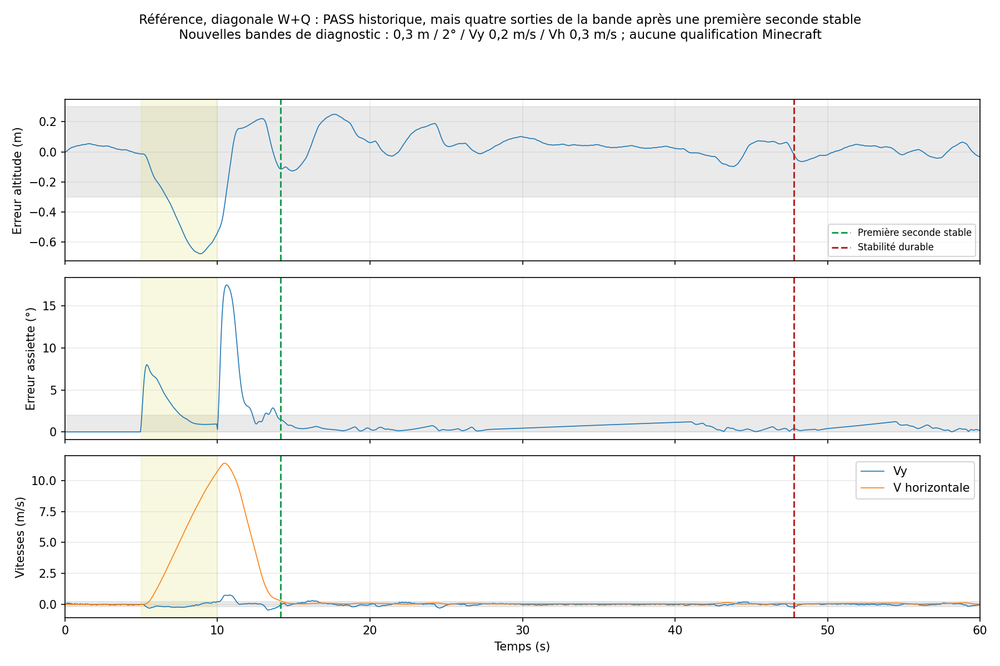
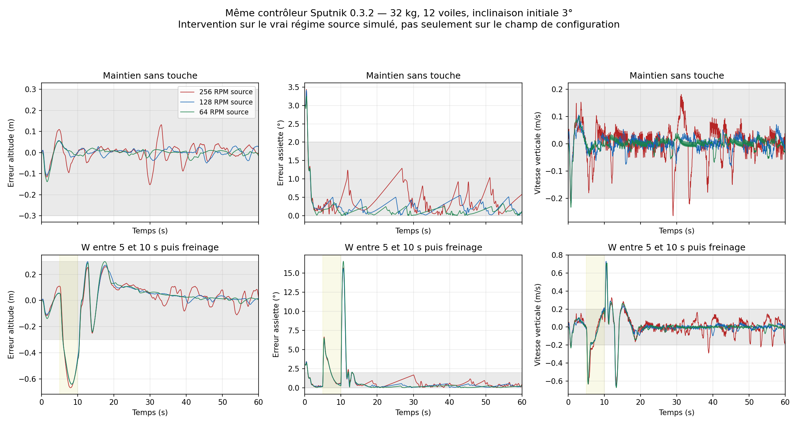

# Recherche : oscillations avant stabilisation — Sputnik 0.3.2

**Le contrôleur et le TXT distribués restent inchangés.** Cette recherche explique pourquoi un PASS final ne garantit pas une transition rapide. Aucun prototype de réglage n’est promu en correctif universel et aucun essai Minecraft n’est revendiqué.

Les recherches réunissent quatre sources primaires PX4, une vérification du bytecode Aeronautics installé, une nouvelle analyse de **552 traces natives**, **72 essais supplémentaires dans LuaJ**, puis **1 692 essais exploratoires Lua 5.2 C** de 47 profils / 46 contrôleurs distincts. Les essais exploratoires représentent 28,15 heures mécaniques simulées effectivement exécutées ; neuf scénarios divergent et s’arrêtent avant 60 s. Leur résultat ne constitue pas une validation native Sputnik.

## 1. Les critères précédents ne mesuraient pas suffisamment la transition

La campagne historique reste intacte : 393 PASS / 159 FAIL / 24 REFUSED. Ses conditions finales autorisent un véhicule à osciller avant de réussir. Le maintien nominal démarrait également avec une attitude parfaitement horizontale, sans perturbation initiale. Ce protocole ne suffisait pas à exclure le problème signalé par le joueur.

Diagnostic ajouté : parmi les 393 PASS historiques, **227** retrouvent une stabilité durable en au plus 8 s, **143** mettent davantage de temps, et **23** ne présentent pas une seconde terminale entière respectant les bandes plus strictes. Ces nouvelles bandes sont un objectif de recherche, pas une réécriture des anciens critères : erreur de hauteur <0,3 m, erreur d’assiette <2°, |Vy|<0,2 m/s, Vh<0,3 m/s après commande horizontale. Le délai part de la fin de commande ou de la perturbation, suivant le protocole.

Le calcul distingue la première seconde stable et le début d’une stabilité qui ne sort plus des bandes jusqu’à la fin de la trace. Il compte aussi les sorties après une première fenêtre stable. Les données absentes, non finies, non fraîches ou interrompues ne produisent pas de succès.

Exemple de référence W+Q : première seconde stable 4,15 s après relâchement, puis quatre sorties des bandes ; stabilité durable seulement après 37,8 s. Ce délai strict inclut de petites réexcursions de vitesse et ne signifie pas une oscillation de grande amplitude pendant 37,8 s.

## 2. La résolution utile des transmissions est insuffisante autour du maintien

À Y=80, pression de référence 0,934185633. Avec 32 kg, gravité 11 et quatre hélices de 12 voiles, la loi auditée donne environ **11,33 RPM par hélice** pour porter le véhicule à plat. À une source réelle de 256 RPM, le signal 14 donne 16 RPM et le signal 15 donne zéro. Le maintien utilise donc une modulation temporelle entre ces niveaux, pas un niveau stationnaire unique.

La variation statique du collectif entre ces deux niveaux vaut environ **15,53 m/s²** avant amortissement par la montée en régime. Sur une hélice de 24 voiles, elle atteint **43,93 m/s²** pour la même masse. Ces nombres sont des écarts d’autorité par niveau, pas des accélérations mesurées instantanément sur le véhicule.

La quantification temporelle est donc nécessaire, mais la séquence des impulsions doit respecter la dynamique des rotors. Le fait que les signaux se moyennent correctement ne garantit pas une faible excursion d’assiette ni une stabilisation rapide.

## 3. Le retard mécanique est réel et s’additionne au filtrage

Le bytecode de `PropellerBearingBlockEntity.updateRotationSpeed()` dans Aeronautics 1.3.2 applique un lissage de coefficient `0.4 / sqrt(totalSailPower)` à chaque tick. Pour 12 voiles : coefficient 0,11547, constante de temps équivalente 0,408 s ; pour 24 voiles : 0,587 s. Le JAR audité n’est pas redistribué ; ses empreintes et le constat d’audit sont conservés dans [physics-audit.json](physics-audit.json).

Le contrôle ajoute les changements de pose à 20 Hz, un filtre de vitesse angulaire de constante nominale 0,025 s, un filtre d’accélération de 0,12 s et le retard Link/observation éventuel. Leur effet exact dépend de la boucle fermée ; additionner ces valeurs ne fournit pas à lui seul une marge de phase.

Les sources PX4 expliquent que les filtres échangent bruit et retard, qu’un gain élevé peut engendrer des oscillations, et que les intégrateurs doivent tenir compte des saturations. Les fréquences PX4 de centaines/milliers de Hz ne sont pas transposables directement à un calcul Sputnik à 20 Hz. Ajouter aveuglément un filtre notch n’est pas une solution démontrée : le banc reproduit déjà le problème sur un corps rigide sans vibration de structure.

## 4. Une intervention mécanique simple améliore la référence, sans résoudre les retards

Le contrôleur est strictement le fichier distribué 0.3.2, SHA-256 `e7399163d4a2a5d9ab9e5da1bfd2c4e06f30c951236f2b27f11ba4c61bc615ac`. Le régime source change **à la fois dans le modèle mécanique du banc et dans la configuration envoyée au pilote**. Il ne suffit donc pas de modifier le champ RPM dans Minecraft : il faut réellement régler le moteur ou installer une réduction en amont.

| Source réelle | État initial | Maintien : stabilité durable | Freinage W : stabilité durable après relâchement |
| ---: | --- | ---: | ---: |
| 256 RPM | 0° | 0.00 s | 8.95 s |
| 256 RPM | 3° | 33.70 s | 46.60 s |
| 128 RPM | 0° | 0.00 s | 5.75 s |
| 128 RPM | 3° | 0.90 s | 5.65 s |
| 64 RPM | 0° | 0.00 s | 5.95 s |
| 64 RPM | 3° | 0.90 s | 6.00 s |

À 128 RPM, le plus petit niveau non nul devient 8 RPM : davantage de niveaux sont utilisables autour de 11,33 RPM. La référence démarrée à 3° passe de 33,70 s à 0,90 s de stabilisation durable en maintien ; le freinage passe de 46,60 s à 5,65 s. Le seuil est celui du diagnostic strict ci-dessus, pas une promesse de performances Minecraft.

**Cette modification ne corrige pas le profil avec retard radio et réponse rotor altérée.** Sur ce profil, le maintien à 3° reste en échec aux trois régimes testés. Elle ne remplace donc pas une correction de la dynamique et ne peut pas être appliquée automatiquement comme un changement logiciel de RPM. Aucune limite logicielle globale de vitesse n’a été ajoutée.

## 5. Les réglages explorés ne justifient pas un nouveau TXT correctif

47 profils ont été évalués sur les mêmes six configurations et six mouvements : démarrage à froid, perturbation diagonale, freinage, montée, diagonale W+Q et charge pendulaire. La référence exploratoire réussit 17/36 anciens critères. Les meilleurs profils montent à 21/36, mais régressent sur des transitions ou conservent des stabilisations longues. Aucun n’atteint tous les mouvements, même dans ce sous-ensemble.

Les recherches couvrent : gains de vitesse/accélération angulaires, réduction du proportionnel, compensation moteur, filtrage du gyroscope estimé, compensation du débit local, apprentissage passif au repos, hystérésis/lissage du mode vertical, suppression de l’intégrale de hauteur et quatre prototypes d’allocation prédictive. Une suppression uniforme du terme d’accélération ou une baisse uniforme des gains dégrade souvent fortement le résultat. Le prototype prédictif à deux ticks réussit 21/36 mais ne règle pas le temps de stabilisation durable ; il n’est pas livré.

En maintien, le gain proportionnel est borné à 4 : le profil nommé `p2` ne constitue donc pas un essai à gain effectif 2. Les termes de récupération peuvent encore différer. Une variante du même contrôleur de base est exécutée deux fois pour contrôle, d’où 47 profils mais 46 empreintes distinctes. Les noms de profils décrivent les changements de source ; les valeurs réellement bornées restent celles du Lua exécuté.

| Étape | Profil | Anciens critères réussis /36 | Nouveaux diagnostics durables ≤8 s /36 |
| --- | --- | ---: | ---: |
| 1 | baseline | 17 | 9 |
| 1 | dr3-da0 | 10 | 9 |
| 1 | dr3-da0.3 | 9 | 9 |
| 1 | dr3-da0.6 | 13 | 9 |
| 1 | dr4-da0 | 9 | 9 |
| 1 | dr4-da0.3 | 11 | 10 |
| 1 | dr4-da0.6 | 12 | 9 |
| 1 | dr6-da0 | 10 | 9 |
| 1 | dr6-da0.3 | 14 | 9 |
| 1 | dr6-da0.6 | 13 | 9 |
| 1 | dr8-da0 | 12 | 9 |
| 1 | dr8-da0.3 | 14 | 9 |
| 1 | dr8-da0.6 | 14 | 10 |
| 1 | force-gain1 | 15 | 10 |
| 1 | no-lead | 12 | 11 |
| 1 | da0-force1 | 10 | 11 |
| 2 | dr8-da1.2 | 17 | 9 |
| 2 | dr8-da2 | 17 | 9 |
| 2 | dr8-da3 | 19 | 10 |
| 2 | dr10-da1.2 | 19 | 11 |
| 2 | dr10-da2 | 20 | 9 |
| 2 | dr10-da3 | 21 | 10 |
| 2 | dr12-da1.2 | 17 | 10 |
| 2 | dr12-da2 | 20 | 11 |
| 2 | dr12-da3 | 20 | 10 |
| 2 | p2 | 21 | 9 |
| 2 | p4 | 21 | 9 |
| 2 | p6 | 19 | 11 |
| 2 | observer-quiet | 20 | 11 |
| 2 | torque-damping | 18 | 9 |
| 2 | no-rate-filter | 18 | 9 |
| 3 | flow0-dr8-da1.2 | 18 | 11 |
| 3 | flow0-dr8-da3 | 18 | 10 |
| 3 | flow0.25-dr8-da1.2 | 18 | 9 |
| 3 | flow0.25-dr8-da3 | 20 | 11 |
| 3 | flow0-ref1 | 18 | 9 |
| 4 | latched-vertical | 17 | 10 |
| 4 | smooth-vertical | 18 | 11 |
| 4 | hysteresis-vertical | 17 | 11 |
| 5 | no-height-integral | 19 | 10 |
| 5 | noI-quiet | 17 | 12 |
| 5 | noI-smooth | 17 | 10 |
| 5 | noI-latched | 16 | 11 |
| 6 | h1-l1 | 16 | 8 |
| 6 | h2-l1 | 21 | 6 |
| 6 | h4-l1 | 15 | 6 |
| 6 | h4-l3 | 14 | 6 |

## 6. Conséquence pour la suite du contrôleur

Les essais justifient de travailler sur une commande des moteurs tenant compte de la réponse et de la quantification, une boucle de vitesse angulaire séparée de la demande d’assiette, une adaptation au retard observable et des observateurs/intégrateurs qui ne se corrigent pas mutuellement pendant une transition. Ils ne justifient pas encore de sélectionner un nouveau jeu de gains par défaut. Les prototypes doivent désormais être jugés sur les excursions et les réentrées dans la bande pendant toute la transition, avec perturbations initiales, en plus des critères finaux.

Pour le véhicule de référence, une réduction **physique** à 128 RPM en amont des transmissions, renseignée ensuite à 128 dans Montage, constitue une piste testée et réversible. La poussée maximale et la marge de montée doivent rester suffisantes pour la charge réelle ; les montages différents demandent leurs propres essais. Le contrôleur distribué reste en version 0.3.2.

## Sources primaires

- [PX4 — Filter Tuning & Control Latency](https://docs.px4.io/main/en/config_mc/filter_tuning.html) : effet du filtrage, du délai et du bruit.
- [PX4 — Multicopter PID tuning](https://docs.px4.io/main/en/config_mc/pid_tuning_guide_multicopter.html) : symptômes selon les gains et essais de réponse.
- [PX4 — RateControl](https://github.com/PX4/PX4-Autopilot/blob/main/src/lib/rate_control/rate_control.cpp) : boucle de vitesse angulaire, dérivée mesurée et anti-windup selon saturation.
- [PX4 — PositionControl](https://github.com/PX4/PX4-Autopilot/blob/main/src/modules/mc_pos_control/PositionControl/PositionControl.cpp) : contrôle de vitesse, allocation verticale et anti-windup.

URLs brutes, date de consultation et empreintes dans [sources.json](sources.json). Ce sont des références de méthode, pas une preuve de compatibilité des paramètres PX4 avec Sputnik.

## Données et reproduction

- [552 diagnostics natifs](native-campaign-transients.json), provenant des traces immuables de [la campagne 0.3.2](../quad-campaign-0.3.2/README.md).
- [72 interventions natives](native-interventions.json), avec paramètres, empreintes et résultats par mouvement ; 45 PASS /27 FAIL selon les anciens critères. [Table lisible des 72 mouvements](NATIVE-MOVEMENTS.md).
- [1 692 explorations](explorations.json), chaque mouvement avec critères, métriques, diagnostic transitoire et SHA de sa trace.
- [Artefacts et empreintes](artifacts.json), [environnement](environment.json), [vérification](validation.log).

Analyse portable : `python3 tools/analyze-sputnik-quad-ringing.py --report platforms/sputnik/reports/quad-campaign-0.3.2 --output /tmp/ringing-analysis` ; tests : `python3 tools/test-quad-ringing-diagnostics.py`. Audit complet : `python3 tools/verify-sputnik-quad-ringing.py --report platforms/sputnik/reports/quad-ringing-0.3.2`. Ces diagnostics n’émettent aucune commande matérielle.

Les archives conservent toutes les traces, contrôleurs exploratoires, scripts exacts de recherche, entrées et journaux. Les scripts gelés reflètent les chemins de cet environnement et nécessitent d’adapter ces chemins pour une nouvelle installation. Les sources indépendantes du banc, critères et contrôleur distribué sont aussi dans l’archive native. Les scripts de rendu/assemblage de cette exécution sont dans `reproduce/`. Les archives scientifiques sont séparées du ZIP de vol de 962 528 octets.

- [exploratory-traces-1.zip](exploratory-traces-1.zip) : 59.3 Mo.
- [exploratory-traces-2.zip](exploratory-traces-2.zip) : 57.0 Mo.
- [exploratory-traces-3.zip](exploratory-traces-3.zip) : 19.1 Mo.
- [exploratory-traces-4.zip](exploratory-traces-4.zip) : 11.3 Mo.
- [exploratory-traces-5.zip](exploratory-traces-5.zip) : 14.9 Mo.
- [exploratory-traces-6.zip](exploratory-traces-6.zip) : 18.6 Mo.
- [native-interventions.zip](native-interventions.zip) : 8.5 Mo.
