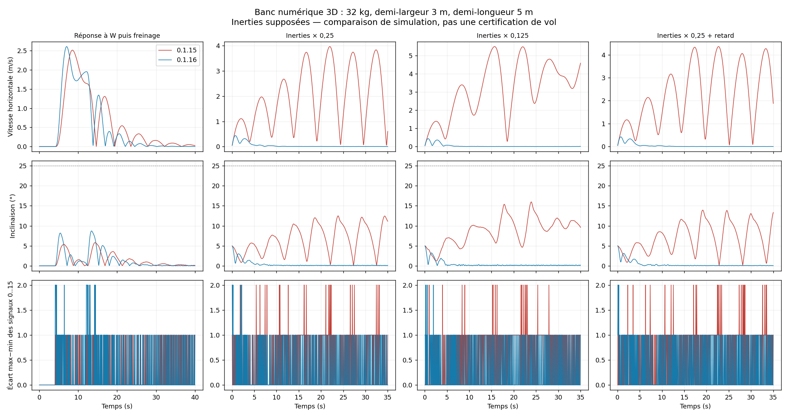

# Résonance et réponse du quad — Sputnik 0.1.16

Les essais de la 0.1.15 ne suffisaient pas à valider un pilotage réactif.
La nouvelle suite reproduit une oscillation entretenue à faibles inerties,
puis compare les vrais scripts livrés avant/après correction dans le LuaJ
de Cosmonautics 26.08.307. **Les résultats restent des simulations : aucun vol
Minecraft du joueur n'a été observé par ce banc.**

Le profil principal reprend **32 kg, demi-largeur 3 blocs, demi-longueur
5 blocs**. La hauteur des hélices (+1 bloc), Y=80, le centrage et les inerties
250/400/230 kg·m² restent des hypothèses. Des cas divisent les inerties par 4
ou 8 et ajoutent du retard ; le pilote reçoit ces inerties par les API simulées.

| Mesure sur le même profil de 32 kg | 0.1.15 | 0.1.16 |
| --- | ---: | ---: |
| Cas de référence réussis, critères renforcés | 25/28 | **28/28** |
| Temps pour atteindre 1 m/s sous W, consigne 2 m/s | 2,10 s | **1,40 s** |
| Angle RMS final, inerties divisées par 4 | 8,38° | **0,095°** |

Les deux configurations supplémentaires réussissent **20/20** essais : un quad
de 65 kg, demi-longueur 2 m, et le quad de 32 kg avec inerties très dissymétriques
800/600/60 kg·m². Le retard de quatre ticks est inclus dans chacune.
Au total : **48/48 essais de référence**, un essai supplémentaire de montée en
régime ralentie réussi, et **six échecs persistants** avec un montage qui ne
correspond pas au modèle. Les 55 exécutions finales et tous leurs échecs sont
conservés dans les tableaux ci-dessous. Les configurations supplémentaires ne
sont pas comparées à l'ancienne version dans ce rapport.



## Correction retenue

L'inversion de l'écoulement créé par la rotation cherchait à annuler un
amortissement aérodynamique utile. En passant par les transmissions et les
hélices retardées, elle pouvait entretenir l'oscillation. Le contrôleur
conserve désormais cet amortissement passif ; il continue de compenser
l'écoulement de translation et la pression à chaque rotor.

L'amortissement utilise les angles mesurés récents, une vitesse angulaire
filtrée et une accélération angulaire filtrée séparément. La commande devient :

`accélération demandée = P × erreur d'angle − 4,5 × vitesse − 0,6 × accélération`

En mode physique, `P = clamp(3 + 6 × bras² × poussée × pression /
(écoulement × inertie), 4, 40)`, calculé séparément pour tangage et roulis.
Cette approximation de l'amortissement des deux rotors montants permet de
rester réactif sans imposer les mêmes gains à toutes les inerties. La boucle
de translation passe aux gains position/vitesse 0,3/0,9. Les limites d'attitude,
la validation de modèle, les bornes des sorties et le réarmement restent actifs.
Les premières variantes plus rapides échouaient au retard de quatre ticks sur
les autres géométries ; le réglage publié privilégie les résultats des trois
configurations plutôt que le meilleur temps d'une seule.

L'écoulement **complet**, y compris la rotation, reste dans la plante de test.
Les hélices gardent leur inertie de régime de 0,15 par tick, les transmissions
leurs 16 états réels, et le graphe son délai de propagation. La physique n'a
pas été simplifiée pour faire passer le correcteur. Le test de montée en régime
ralentie utilise 0,08 pour sonder une incertitude ; ce n'est pas le coefficient
audité d'Aeronautics stock.

## Critères et scénarios

Une réussite exige un pilote actif pendant tout l'essai, une erreur finale
verticale et horizontale < 0,3 m, une vitesse finale < 0,2 m/s, et une inclinaison
maximale < 25°. En plus, sur les dix dernières secondes, l'angle RMS doit rester
< 2° et la vitesse RMS < 0,2 m/s. Le dernier échantillon ne peut plus masquer
une oscillation persistante. Ces critères ne garantissent pas une erreur
transitoire inférieure au mètre pendant un rattrapage de chute.

Les nouveaux cas incluent des inversions W/S toutes les 0,5 s et 1 s, des efforts
périodiques à 0,5/1 Hz, du bruit d'attitude de 0,1°, une commande W prolongée et
des inerties divisées jusqu'à huit. Les métriques T50 et RMS sont mesurées sur
les traces physiques, pas sur la seule consigne envoyée. Trois cas de faibles
inerties sont ajoutés comme régressions avec assertions à la suite standard.

Les six échecs concernent les décalages de centre de masse de 10/25 cm, un rotor
affaibli de 10 %, une inversion avant/arrière des fréquences, un émetteur
concurrent à 15 et une transmission mécanique inversée. Certains se stabilisent
avec un **écart horizontal trop grand** ; d'autres se retournent. Ce ne sont pas
des réussites ni des défauts tous détectés avant décollage. Leur correction
demande une identification du montage réel, pas uniquement des gains plus forts.

## Résultats et provenance

- [Ancien contrôleur, profil joueur](baseline-0.1.15.md) — [CSV](baseline-0.1.15.csv), [paramètres et SHA256](baseline-0.1.15.json).
- [Contrôleur publié, profil joueur](corrected-0.1.16.md) — [CSV](corrected-0.1.16.csv), [paramètres et SHA256](corrected-0.1.16.json).
- [Autre géométrie, 65 kg](holdout-short.md) — [CSV](holdout-short.csv), [paramètres](holdout-short.json).
- [Inerties dissymétriques](holdout-mixed.md) — [CSV](holdout-mixed.csv), [paramètres](holdout-mixed.json).

La plante reste un corps rigide indépendant à quaternion, intégration 200 Hz,
contrôleur 20 Hz, forces aux quatre points et courbe de pression issue de Java
Sable. Elle continue après un défaut. Elle ne lance pas Minecraft, les collisions,
le réseau cinétique Create ou le solveur Sable. Les inerties et le centre de
masse réels restent inconnus ; `Ixyz` sur le panneau d'audit expose maintenant
les trois inerties natives pour les prochains essais. Aucun certificat de vol
ou d'autopilote universel n'est déduit de ce rapport.

Pour reproduire le profil joueur, depuis la racine du dépôt :

```sh
python3 tools/test-sputnik-twin.py \
  --cosmonautics-jar /chemin/cosmonautics-26.08.307.jar \
  --java-home /chemin/jdk-21 --mass 32 --arm-x 3 --arm-z 5 \
  --output /tmp/quad-0116
```

Le dossier de sortie contient toutes les traces CSV, y compris celles des
échecs. L'option `--cases` sélectionne des noms de scénarios pour les comparaisons
ciblées ; `--controller-file` et `--controller-version` sélectionnent une autre
version sans modifier les autres nœuds. Le succès d'exécution du générateur
signifie que le rapport est produit, pas que tous ses scénarios passent.
Les essais volumineux ne sont pas intégrés au ZIP de l'OS.
