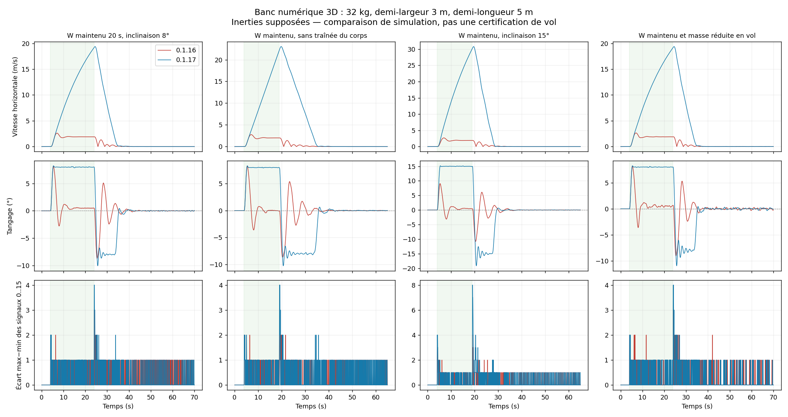

# Inclinaison maintenue et vitesse horizontale — 0.1.17

Le changement concerne la commande de déplacement : maintenir W/S/Q/D demande
une **inclinaison constante**, au lieu de poursuivre une vitesse plafonnée à
2 m/s. Le contrôleur conserve les gains d'attitude de la 0.1.16 qui fonctionnaient
sur le véhicule du joueur. Les scripts publiés sont exécutés dans le LuaJ de
Cosmonautics face à la plante 3D indépendante ; **aucune vitesse réelle du
serveur n'est certifiée par ces essais**.

## Résultats sur le profil déclaré de 32 kg

Le profil utilise une demi-largeur de 3 blocs et une demi-longueur de 5 blocs.
Les inerties 250/400/230 kg·m², le centrage, l'altitude Y=80, les rotors à +1 bloc
et les coefficients de traînée restent des hypothèses. À 256 RPM, le modèle
reprend bien un écoulement de **25,6 m/s**.

| W maintenu 20 s, inclinaison configurée 8° | 0.1.16 | 0.1.17 |
| --- | ---: | ---: |
| Tangage moyen pendant la partie établie de l'appui | 0,38° | **8,00°** |
| Écart-type du tangage sur cette partie | 0,66° | **0,034°** |
| Vitesse horizontale maximale observée | 2,60 m/s | **19,37 m/s** |
| Retour arrière maximal après relâchement | 2,52 m | **0,19 m** |
| Erreur verticale transitoire maximale | 0,20 m | **0,43 m** |

Le test à **15°**, pendant 15 secondes d'appui, atteint **30,80 m/s** avec
une moyenne de tangage de 15,00° et un écart-type de 0,035°. Il atteint 1 m/s
en 1,05 s, contre 1,40 s dans le test à 8°. Son excursion verticale atteint
**1,55 m** : le gain de vitesse ne garantit pas une précision verticale au
mètre à tout instant. Ces vitesses sont des pics dans des scénarios définis,
pas des plafonds programmés ni les vitesses terminales mesurées du vrai quad.



## Déplacement, freinage, maintien

- `TRAVEL` : l'appui conserve l'inclinaison choisie, les diagonales sont
  normalisées et la vitesse peut continuer à augmenter. Le paramètre `speed`
  ne limite plus cette phase.
- `BRAKE` : au relâchement, la vitesse est freinée avec une anticipation de
  0,4 s de l'accélération mesurée pour compenser le retard des hélices.
- `HOLD` : le point d'arrêt est capturé lorsque la vitesse et l'attitude sont
  faibles. Le pilote ne revient plus au point de relâchement. La transition
  utilise des seuils physiques, pas une attente ou un délai maximal.

Le champ « vitesse retour maintien » ne règle que le retour en position pendant
`HOLD`. L'inclinaison de déplacement reste 8° par défaut, réglable jusqu'à 15°.
Modifier la configuration avec l'autorisation coupée ; les changements de
configuration en vol conservent le mécanisme existant de mise en défaut.
Space/Shift et la conservation de la cible d'altitude restent disponibles.
Le statut affiche la phase et `Vh` ; l'audit expose aussi une vitesse native
lue indépendamment par `getVelocity`.

La garde contre les sauts de position compare maintenant la mesure à la
position prédite par la vitesse suivie. Elle ne rejette plus une grande
distance parcourue correctement prédite comme si elle était un téléportage.
Le test unitaire vérifie à la fois ce suivi rapide et le rejet d'un saut
imprévu ; cela ne valide pas un vol physique à cette vitesse arbitraire.

## Sustentation et limites de vitesse

Il n'y a pas de plafond horizontal fixé en m/s. Le maximum réel dépend de la
poussée, de l'écoulement, de la pression, de la masse, de l'inclinaison autorisée
et de la traînée du véhicule. Cette dernière n'est pas connue par Sputnik stock.
Le code prédit la portance maximale pour l'inclinaison demandée et réduit cette
inclinaison s'il ne reste pas **10 % de réserve de poussée**. Cette réserve laisse
de la place aux corrections d'attitude et au retard des hélices.

Le statut `LIFT_LIMIT` signale cette réduction, sans inventer un plafond en m/s.
À 85 kg, le scénario ne possède pas cette réserve : il reste en maintien avec
une vitesse horizontale nulle. Il est classé **LIFT_LIMIT**, pas comme une
réussite de déplacement.

Un essai volontairement extrême supprime toute traînée du corps et maintient W
80 secondes. Il atteint 123,20 m/s, réduit ensuite l'inclinaison lorsque la
réserve diminue, puis freine et revient au maintien sans défaut. Son excursion
verticale maximale atteint **3,25 m**. Un premier réglage avec seulement 2 % de
réserve perdait sa sustentation ; il n'est pas publié. L'essai extrême n'est pas
une promesse de vitesse ou de précision sur le serveur Minecraft.

## Couverture et reproduction

Sur le même banc et les mêmes critères : **32/32 cas de référence** passent
pour le profil joueur, contre 28/32 avec la 0.1.16. Les quatre nouvelles
exigences de déplacement prolongé échouent sur l'ancien comportement limité
en vitesse. Les 28 anciens cas restent réussis.

Deux autres configurations réussissent **20/20** essais supplémentaires :
65 kg avec demi-longueur de 2 m, et 32 kg avec inerties 800/600/60 kg·m².
Cela fait **52/52 essais de référence**. Sur les neuf essais supplémentaires :
deux passent (montée en régime ralentie et endurance sans traînée), un est
`LIFT_LIMIT`, et six restent des échecs avec un centre de masse mal renseigné,
un rotor affaibli, des fréquences inversées/concurrentes ou une transmission
mécanique inversée. Les **61 exécutions finales** restent toutes consultables.

Les essais prolongés exigent aussi un tangage moyen supérieur à 70 % de la
consigne, un écart-type < 1,5°, une vitesse observée > 8 m/s et un retour arrière
< 0,5 m. Ils conservent les critères d'erreur et de vitesse finales, les limites
d'attitude et les mesures RMS des dix dernières secondes. La suite standard
contient maintenant un essai de déplacement prolongé avec assertions.

- [Ancien contrôleur](baseline-0.1.16.md) — [CSV](baseline-0.1.16.csv), [paramètres et empreintes](baseline-0.1.16.json).
- [Contrôleur publié](corrected-0.1.17.md) — [CSV](corrected-0.1.17.csv), [paramètres et empreintes](corrected-0.1.17.json).
- [Autre géométrie](holdout-short.md) — [CSV](holdout-short.csv), [paramètres](holdout-short.json).
- [Inerties dissymétriques](holdout-mixed.md) — [CSV](holdout-mixed.csv), [paramètres](holdout-mixed.json).

La plante conserve l'écoulement complet au point de chaque hélice, la dynamique
rigide 3D, les régimes retardés, les signaux quantifiés et la propagation du
graphe. Elle ne lance pas le solveur Sable, les collisions ou le réseau cinétique
Create. Les inerties et le centre de masse réels restent à mesurer ; les
performances restent donc celles d'un modèle paramétré.

```sh
python3 tools/test-sputnik-twin.py \
  --cosmonautics-jar /chemin/cosmonautics-26.08.307.jar \
  --java-home /chemin/jdk-21 --mass 32 --arm-x 3 --arm-z 5 \
  --output /tmp/quad-0117
```

Pour refaire la figure avec les deux dossiers de traces : utiliser
`tools/plot-sputnik-twin.py --before ... --after ... --travel --output ...`.
Les traces complètes restent dans le dossier de sortie et ne grossissent pas
le ZIP de l'OS. Le générateur produit un rapport même si certains essais
échouent : consulter sa colonne `status` pour leur verdict individuel.
